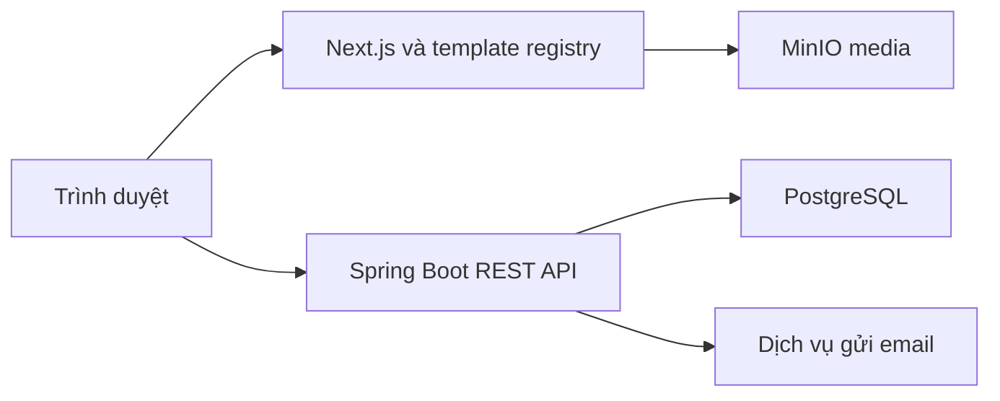
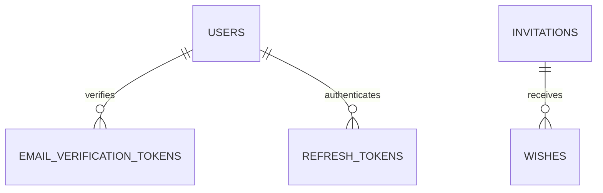

# Architecture Design Document (ADD)

> Modular monolith Spring Boot và ứng dụng Next.js. Baseline mã nguồn `679cc41`. Xem [PRD](PRD.md) và [Event Storming](Event_Storming.md).

## 1. Thành phần và ranh giới

- Frontend dùng Next.js 14 App Router, React 18, TypeScript và Tailwind 3. App gọi backend qua các module trong [services](../frontend/src/services). `NEXT_PUBLIC_API_URL` cấu hình địa chỉ API.
- Backend dùng Java 21, Spring Boot 4.1.1, Spring Security, Spring Data JPA và Maven. Các package nghiệp vụ `auth`, `template`, `invitation`, `wish` dùng controller, DTO, service và repository trong cùng một ứng dụng. `WishService` truy vấn Invitation repository để xác định thiệp rồi đọc hoặc ghi Wish repository. [pom.xml](../backend/pom.xml)
- PostgreSQL 16 lưu dữ liệu ứng dụng. MinIO lưu ảnh, font, nhạc và tài nguyên của mẫu. Next.js rewrite vùng URL media `/templates/:template/:directory/:path*` sang bucket theo `STORAGE_ENDPOINT` và `STORAGE_BUCKET_NAME`. CSS template có thể nằm trong `frontend/public/template-designs`. [Compose](../docker-compose.yml), [Next config](../frontend/next.config.mjs), [quy trình nhập mẫu](templete/quy-trinh-chuyen-doi-mau-thiep.md)
- Compose hiện đóng gói backend, PostgreSQL và MinIO. Frontend chạy riêng. Hibernate dùng `ddl-auto: update` ở dev và `validate` ở prod, nên môi trường prod cần schema phù hợp trước khi backend khởi động. [Dev](../backend/src/main/resources/application-dev.yml), [Prod](../backend/src/main/resources/application-prod.yml)



## 2. Dữ liệu lưu trữ

| Bảng | Khóa và quan hệ | Dữ liệu chính |
|---|---|---|
| `users` | UUID, unique email | Password hash, tên, role, trạng thái xác minh |
| `email_verification_tokens` | UUID, FK `user_id`, unique token | Thời điểm hết hạn |
| `refresh_tokens` | UUID, FK `user_id`, unique token hash | Hết hạn, thu hồi và hash token thay thế |
| `templates` | ID số, unique `code` | Trạng thái, version của bản ghi, `forked_from_id`, `default_data` và `content_schema` kiểu `TEXT` |
| `invitations` | ID số, unique `slug`, `user_id` UUID nullable, `template_id` chuỗi | Thông tin cưới, trạng thái, `content_schema TEXT NOT NULL`, dấu thời gian tạo và sửa |
| `wishes` | ID số, FK `invitation_id`, index `(invitation_id, created_at DESC)` | `guest_name` tối đa 100, `attendance_status`, `guest_count`, `message` tối đa 500, `created_at` |

`Invitation.userId` và `Invitation.templateId` là trường scalar. Renderer ghi `PageSchema.template = { id, version }` vào snapshot khi dùng luồng tạo mới từ frontend. Phiên bản package, `PageSchema.version` và version của bản ghi mẫu phục vụ các mục đích riêng. [Invitation entity](../backend/src/main/java/com/wedding/invitation/entity/Invitation.java), [Template entity](../backend/src/main/java/com/wedding/template/entity/Template.java), [Wish entity](../backend/src/main/java/com/wedding/wish/entity/Wish.java), [Registry](../frontend/src/templates/registry.ts)



## 3. Hợp đồng REST

Tiền tố các đường dẫn trong bảng là `/api/v1`. JSON dùng `ApiResponse<T>` với `code`, `message` và `data`. DTO yêu cầu được validate tại controller. [ApiResponse](../backend/src/main/java/com/wedding/common/dto/response/ApiResponse.java)

| API ID | Method và path | Quyền hiện tại | Kết quả thành công |
|---|---|---|---|
| `API-01` | `POST /auth/register` | Public | `201`, thông tin đăng ký |
| `API-02` | `POST /auth/login` | Public | `200`, thông tin người dùng và cookie phiên |
| `API-03` | `GET /templates?category=...` | Public | `200`, mẫu đã xuất bản. Category tùy chọn |
| `API-08` | `GET /public/invitations/{slug}` | Public | `200`, metadata thiệp và `contentSchema` kiểu string |
| `API-09` | `POST /public/invitations/{slug}/wishes` | Public | `201`, bản ghi lời chúc và RSVP |
| `API-12` | `POST /public/invitations/quick-create` | Public, có thể nhận principal | `201`, thiệp `PUBLISHED`, slug và `publicUrl` |
| `API-13` | `GET /public/invitations/{slug}/wishes?page=0&size=10` | Public | `200`, Spring Data Page, mới nhất trước. Page tối thiểu 0, size từ 1 đến 50 |
| `API-14` | `GET /templates/{codeOrId}` | Public | `200`, chi tiết mẫu, schema và dữ liệu mặc định |
| `API-15` | `POST /templates` | Public | `201`, mẫu mới |
| `API-16` | `POST /templates/{id}/clone` | Public | `201`, mẫu nhân bản |
| `API-17` | `PUT /templates/{id}` | Public | `200`, mẫu cập nhật |
| `API-18` | `POST /auth/verify-email`, `POST /auth/resend-verification` | Public | `200`, xác minh hoặc xử lý yêu cầu gửi lại |
| `API-19` | `POST /auth/refresh`, `POST /auth/logout` | Public ở tầng route, xử lý phiên dựa trên cookie | `200`, làm mới hoặc kết thúc phiên |
| `API-20` | `GET /auth/me`, `PUT /auth/password` | Yêu cầu xác thực ở tầng method | `200`, thông tin người dùng hoặc xác nhận đổi mật khẩu |

| API ID | Hợp đồng dự kiến | Điều kiện trước khi triển khai |
|---|---|---|
| `API-04` | Khởi tạo bản nháp từ mẫu | Chốt vòng đời nháp và quyền sở hữu tại `FR-08` |
| `API-05` | Đọc chi tiết thiệp để chỉnh sửa | Kiểm tra quyền theo `BR-01` |
| `API-06` | Cập nhật schema thiệp đã lưu | Bảo toàn slug và kiểm tra quyền theo `BR-01`, `BR-02` |
| `API-07` | Xuất bản bản nháp | Chốt trạng thái và hành vi khi gọi lại |
| `API-10` | Xóa lời chúc theo ID thiệp và ID lời chúc | Cả bản ghi lời chúc và quyền chủ thiệp phải khớp |
| `API-11` | Tải báo cáo RSVP dạng CSV | Chốt cột và encoding theo `Q-PRD-02` |

Hợp đồng hiện hành đối chiếu theo [AuthController](../backend/src/main/java/com/wedding/auth/controller/AuthController.java), [TemplateController](../backend/src/main/java/com/wedding/template/controller/TemplateController.java), [PublicInvitationController](../backend/src/main/java/com/wedding/invitation/controller/PublicInvitationController.java) và [WishController](../backend/src/main/java/com/wedding/wish/controller/WishController.java). Một số helper trong `services/api.ts` còn dùng đường dẫn cũ. Luồng đang chạy gọi các đường dẫn trên qua `services/invitationService.ts`.

### Quick Create và đọc thiệp

`API-12` yêu cầu `groomName`, `brideName`, `eventDate`, `venueName` và `contentSchema` khác rỗng. Các trường tùy chọn gồm `templateId`, `phoneNumber`, `eventTime`, `venueAddress` và `coverImageUrl`. Frontend serialize snapshot thành chuỗi JSON. Renderer đọc ảnh bìa từ snapshot.

`InvitationService` lưu thiệp trong transaction tại thời điểm tạo. Khi slug cơ sở trùng, service thêm hậu tố ngẫu nhiên. Unique constraint là hàng rào cuối cho ghi đồng thời. Service hiện chưa thử lại khi ghi trùng. `API-08` tìm theo slug và trả `404` nếu thiếu bản ghi. Frontend có fallback cùng trình duyệt và fallback theo mã mẫu. [Service](../backend/src/main/java/com/wedding/invitation/service/InvitationService.java), [Public route](../frontend/src/app/t/%5Bslug%5D/page.tsx)

### Gửi lời chúc và RSVP

Ví dụ payload `API-09`:

```json
{
  "guestName": "Nguyễn An",
  "attendanceStatus": "ATTENDING",
  "guestCount": 2,
  "message": "Chúc hai bạn hạnh phúc!"
}
```

DTO yêu cầu tên khác rỗng và tối đa 100 ký tự, trạng thái `ATTENDING`, `DECLINED` hoặc `MAYBE`, số người từ 0 đến 10 nếu gửi và lời chúc tối đa 500 ký tự. `WishService` lưu 0 người cho `DECLINED`, mặc định 1 cho trạng thái khác khi bỏ trống hoặc gửi 0. Tên và lời chúc được trim. Lời chúc trống lưu null. Thiếu slug trả `404`, payload vi phạm validation trả `400`. Mỗi lượt gửi hợp lệ tạo một bản ghi. Song Hỷ Xanh chuyển lựa chọn của form RSVP thành `ATTENDING` hoặc `DECLINED` qua adapter, còn form lời chúc gửi `MAYBE`. [Adapter Song Hỷ Xanh](../frontend/src/services/songHySourceService.ts) [DTO](../backend/src/main/java/com/wedding/wish/dto/request/SubmitWishRequest.java), [Service](../backend/src/main/java/com/wedding/wish/service/WishService.java)

## 4. Xác thực, quyền và vận hành

- `NFR-SEC-01` dùng BCrypt cost 12. `NFR-SEC-02` dùng JWT và cookie phiên HttpOnly. Refresh token lưu dạng hash, xoay khi refresh. Frontend gửi credentials và có nhánh refresh khi nhận `401` ngoài route auth. [SecurityConfig](../backend/src/main/java/com/wedding/config/SecurityConfig.java), [CookieUtils](../backend/src/main/java/com/wedding/common/util/CookieUtils.java)
- `SecurityConfig` cho phép truy cập `/auth/**`, `/public/**`, `/templates/**`. Auth có giới hạn số lần đăng nhập sai theo email trong bộ nhớ. `NFR-SEC-04` cần cơ chế riêng cho API lời chúc. Phân quyền ghi mẫu và vòng đời chủ thiệp được theo dõi trong [Backlog](BACKLOG.md).
- `NFR-SEC-03` và `NFR-SCAL-01` cần kiểm tra theo adapter/renderer và ở biên API. Quick Create hiện chỉ yêu cầu chuỗi schema khác rỗng. `BR-03` và giới hạn kích thước vẫn cần kiểm chứng.
- `NFR-PERF-01`, `NFR-PERF-02`, `NFR-PERF-03` và `NFR-AVAIL-01` cần số đo theo các điều kiện trong PRD. `NFR-USAB-01` và `NFR-COMP-01` cần browser test theo mẫu và thiết bị mục tiêu. [Báo cáo kiểm tra](CONSISTENCY_REPORT.md)

## 5. Quyết định kiến trúc

| ADR ID | Quyết định | Hệ quả |
|---|---|---|
| `ADR-01` | Modular monolith cho backend | Các nghiệp vụ dùng REST qua một backend. Cross-module hiện có ở truy vấn Invitation cho sổ lưu bút |
| `ADR-02` | PostgreSQL JSONB theo thiết kế ban đầu | Deprecated trong baseline hiện tại. Giữ tham chiếu về `FACT-TECH-03` |
| `ADR-03` | Service concrete, constructor injection, DTO tách request/response | Giữ ranh giới giữa hợp đồng REST và entity |
| `ADR-04` | Renderer package được resolve ở frontend | HB04 v1, Minimalism Đỏ Đậm v1/v2 và Song Hỷ Xanh v1. Schema không có binding dùng legacy adapter. Binding lạ trả lỗi. Giữ renderer lẫn tài nguyên của version đang được thiệp cũ tham chiếu |
| `ADR-05` | Schema mẫu và snapshot thiệp là chuỗi JSON lưu trong `TEXT` | Backend lưu trữ; frontend serialize, parse và dựng hình. Đổi kiểu lưu trữ cần migration và kiểm tra dữ liệu cũ |
| `ADR-06` | Media mẫu trên object storage với URL qua Next.js | Triển khai cần đồng bộ bucket và asset đúng version. Upload ảnh người dùng thuộc `TASK-12` |

Xem [template packages](template-packages.md) và [đối chiếu Song Hỷ Xanh](templete/song-hy-xanh-storage-verification.md) để chuẩn bị tài nguyên mẫu.
