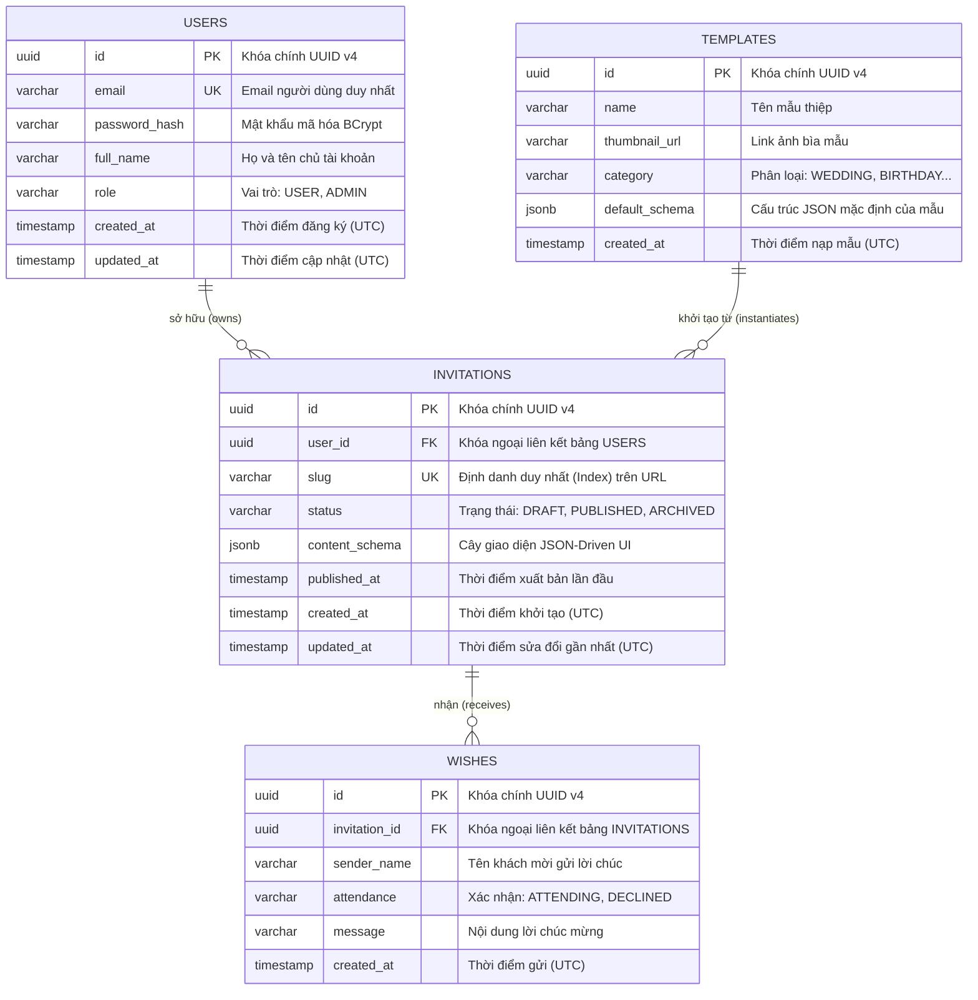

# 🏛️ Architecture Design Document (ADD) - [Modular Monolith]

> **Dự án:** Nền tảng Tạo và Chia sẻ Thiệp Mời Sự Kiện Trực Tuyến (JSON-Driven UI)  
> **Tài liệu tham chiếu thượng nguồn (Upstream):** [docs/Event_Storming.md](file:///d:/Programing_Language/InteliJ_IDEA/Thiep-Moi-Project/docs/Event_Storming.md) | [docs/PRD.md](file:///d:/Programing_Language/InteliJ_IDEA/Thiep-Moi-Project/docs/PRD.md) | [docs/BRD.md](file:///d:/Programing_Language/InteliJ_IDEA/Thiep-Moi-Project/docs/BRD.md)  
> **Người thực hiện:** Lead Software Architect & Tech Lead  
> **Trạng thái:** Hoàn tất (DoD Certified)

---

## 1. Technology Stack (Ngăn Xếp Công Nghệ Chuẩn Hóa)

| Hạng Mục | Công Nghệ Lựa Chọn | Phiên Bản | Lý Do Lựa Chọn (Rationale) |
|:---|:---|:---|:---|
| **Ngôn ngữ Backend** | Java (LTS) | 21 LTS | Hỗ trợ Virtual Threads, Pattern Matching, Record Classes giúp code gọn gàng, hiệu năng cao. |
| **Backend Framework** | Spring Boot | 4.x / 3.3.x | Framework tiêu chuẩn doanh nghiệp, tích hợp Spring Security, Spring Data JPA, Hibernate 6 native JSONB. |
| **Cơ sở dữ liệu** | PostgreSQL | 16+ | Khả năng xử lý kiểu dữ liệu `JSONB` vượt trội, hỗ trợ đánh chỉ mục GIN Index cho truy vấn schema cực nhanh. |
| **Frontend Framework** | Next.js (App Router) | 14+ / 15 | Hỗ trợ Server-Side Rendering (SSR) tối ưu thẻ Meta OpenGraph cho Zalo/Facebook và Code-splitting (`next/dynamic`). |
| **Frontend Styling** | Tailwind CSS | 3.4+ | Tiện ích CSS hiện đại, tối ưu dung lượng bundle xuất xưởng, tương thích tuyệt đối với Mobile-first design. |
| **Quản lý State** | Zustand | 4.5+ | Quản lý cây JSON Schema của Editor gọn nhẹ hơn Redux, không gây re-render dư thừa giữa Form và Phone Preview. |
| **Định danh & Bảo mật** | JJWT (Java JWT) | 0.12+ | Triển khai Stateless JWT Authentication chuẩn RFC 7519, chữ ký HMAC-SHA256 an toàn. |

---

## 2. Modular Architecture & Component Structure (Cấu Trúc Đơn Khối Phân Tầng)

### 2.1. Cấu trúc Gói Chuẩn Hóa (Backend Package Layout)
Tuân thủ nghiêm ngặt **Quy chuẩn Không sử dụng Impl (No-Impl Pattern)** và **Phân tách DTO chuẩn (`dto.request` / `dto.response`)**, mỗi file giới hạn dưới 300 dòng:

```
backend/src/main/java/com/wedding/
├── config/                         # SecurityConfig, WebMvcConfig, CorsConfig
├── common/                         # Lớp dùng chung toàn hệ thống
│   ├── exception/                  # GlobalExceptionHandler, ApiException
│   └── dto/response/               # ApiResponse<T> Wrapper chuẩn
├── auth/                           # Bounded Context: User Identity
│   ├── controller/AuthController.java
│   ├── service/AuthService.java    # Concrete class trực tiếp (Không dùng interface AuthServiceImpl)
│   ├── repository/UserRepository.java
│   ├── entity/User.java
│   └── dto/
│       ├── request/RegisterRequest.java, LoginRequest.java
│       └── response/AuthResponse.java
├── template/                       # Bounded Context: Template Catalog
│   ├── controller/TemplateController.java
│   ├── service/TemplateService.java
│   ├── repository/TemplateRepository.java
│   ├── entity/Template.java
│   └── dto/response/TemplateResponse.java
├── invitation/                     # Bounded Context: Invitation Core (JSON-Driven UI)
│   ├── controller/InvitationController.java, PublicCardController.java
│   ├── service/InvitationService.java, SlugGeneratorService.java
│   ├── repository/InvitationRepository.java
│   ├── entity/Invitation.java
│   └── dto/
│       ├── request/CreateInvitationRequest.java, UpdateSchemaRequest.java
│       └── response/InvitationResponse.java, PublicCardResponse.java
└── wish/                           # Bounded Context: Wishes & RSVP
    ├── controller/WishController.java
    ├── service/WishService.java
    ├── repository/WishRepository.java
    ├── entity/Wish.java
    └── dto/
        ├── request/SubmitWishRequest.java
        └── response/WishResponse.java, RsvpSummaryResponse.java
```

### 2.2. Quy tắc Phụ thuộc Ranh giới Module (Dependency Rules)
1. **Giao tiếp In-Process:** Các module giao tiếp qua **Public Service method** của module đó hoặc qua **Spring `ApplicationEventPublisher`**.
2. **Cấm Cross-Repository:** Module `Wish` tuyệt đối KHÔNG được inject `InvitationRepository`. Nếu cần xác thực thiệp tồn tại, `WishService` phải gọi thông qua `InvitationService`.
3. **Cấm SQL Join liên module ở tầng Database:** Mỗi repository chỉ truy vấn entity thuộc module của chính nó.

---

## 3. Database Schema & ERD (Mô Hình Cơ Sở Dữ Liệu)



### 3.1. Đặc tả chi tiết các Bảng và Chỉ mục (DDL Specifications)

#### Bảng `invitations` (Trọng tâm JSON-Driven UI)
```sql
CREATE TABLE invitations (
    id UUID PRIMARY KEY DEFAULT gen_random_uuid(),
    user_id UUID NOT NULL REFERENCES users(id) ON DELETE CASCADE,
    slug VARCHAR(100) UNIQUE,
    status VARCHAR(20) NOT NULL DEFAULT 'DRAFT',
    content_schema JSONB NOT NULL,
    published_at TIMESTAMP WITH TIME ZONE,
    created_at TIMESTAMP WITH TIME ZONE NOT NULL DEFAULT CURRENT_TIMESTAMP,
    updated_at TIMESTAMP WITH TIME ZONE NOT NULL DEFAULT CURRENT_TIMESTAMP
);

-- Đánh chỉ mục tìm kiếm thiệp theo Slug siêu tốc
CREATE INDEX idx_invitations_slug ON invitations(slug);

-- Đánh chỉ mục GIN cho cột content_schema để truy vấn sâu trong JSONB nếu cần
CREATE INDEX idx_invitations_schema_gin ON invitations USING gin(content_schema);
```

#### Bảng `wishes` (Lời chúc & RSVP)
```sql
CREATE TABLE wishes (
    id UUID PRIMARY KEY DEFAULT gen_random_uuid(),
    invitation_id UUID NOT NULL REFERENCES invitations(id) ON DELETE CASCADE,
    sender_name VARCHAR(50) NOT NULL,
    attendance VARCHAR(20) NOT NULL DEFAULT 'ATTENDING',
    message VARCHAR(500) NOT NULL,
    created_at TIMESTAMP WITH TIME ZONE NOT NULL DEFAULT CURRENT_TIMESTAMP
);

-- Tối ưu hóa truy vấn lấy danh sách lời chúc mới nhất theo thiệp
CREATE INDEX idx_wishes_invitation_created ON wishes(invitation_id, created_at DESC);
```

---

## 4. Interface Contracts (RESTful API Design)

Toàn bộ API trả về cấu trúc wrapper chuẩn `ApiResponse<T>`:
```json
{
  "code": 200,
  "message": "Thành công",
  "data": { ... }
}
```

### Danh mục Chi tiết Các Endpoint

| API ID | Phương Thức | Endpoint | Quyền Hạn | Mô Tả Nghiệp Vụ | HTTP Success |
|:---|:---:|:---|:---|:---|:---:|
| `API-01` | `POST` | `/api/v1/auth/register` | Public | Đăng ký tài khoản mới (`RegisterRequest`) | `201 Created` |
| `API-02` | `POST` | `/api/v1/auth/login` | Public | Đăng nhập nhận JWT Token (`LoginRequest`) | `200 OK` |
| `API-03` | `GET` | `/api/v1/templates` | Public | Lấy danh sách kho mẫu thiệp có sẵn | `200 OK` |
| `API-04` | `POST` | `/api/v1/invitations` | `ROLE_USER` | Khởi tạo thiệp mới từ `templateId` | `201 Created` |
| `API-05` | `GET` | `/api/v1/invitations/{id}` | Owner | Lấy chi tiết JSON Schema để nạp vào Editor | `200 OK` |
| `API-06` | `PUT` | `/api/v1/invitations/{id}` | Owner | Cập nhật bản nháp JSON Schema của thiệp | `200 OK` |
| `API-07` | `POST` | `/api/v1/invitations/{id}/publish` | Owner | Xuất bản thiệp, sinh `slug` bất biến | `200 OK` |
| `API-08` | `GET` | `/api/v1/public/cards/{slug}` | Public | Khách mời lấy JSON Schema để vẽ thiệp | `200 OK` |
| `API-09` | `POST` | `/api/v1/public/cards/{slug}/wishes`| Public | Khách mời gửi lời chúc mừng & RSVP | `201 Created` |
| `API-10` | `DELETE`| `/api/v1/invitations/{id}/wishes/{wishId}`| Owner | Chủ thiệp xóa lời chúc rác | `200 OK` |
| `API-11` | `GET` | `/api/v1/invitations/{id}/wishes/export-csv`| Owner | Tải file CSV danh sách khách và RSVP | `200 OK` (File) |

---

### Mẫu Hợp Đồng Dữ Liệu Đại Diện (Payload Samples)

#### `[API-06]` Cập Nhật JSON Schema (`PUT /api/v1/invitations/{id}`)
- **Request Body:**
```json
{
  "contentSchema": {
    "version": 1,
    "layoutMode": "STACK",
    "theme": {
      "primaryColor": "#D4AF37",
      "backgroundColor": "#FCFBF7",
      "headingFont": "Playfair Display",
      "bodyFont": "Inter"
    },
    "blocks": [
      {
        "id": "blk-hero-01",
        "type": "HERO",
        "props": {
          "title": "Minh Tuấn & Mai Lan",
          "eventDate": "2026-11-20T10:00:00+07:00",
          "coverImageUrl": "https://images.unsplash.com/photo-wedding-demo.jpg"
        }
      },
      {
        "id": "blk-countdown-02",
        "type": "COUNTDOWN",
        "props": {
          "targetDate": "2026-11-20T10:00:00+07:00"
        }
      },
      {
        "id": "blk-location-03",
        "type": "LOCATION",
        "props": {
          "venueName": "Trung tâm Hội nghị Trống Đồng Palace",
          "address": "Số 65 Quán Sứ, Hoàn Kiếm, Hà Nội",
          "mapUrl": "https://maps.google.com/?q=..."
        }
      },
      {
        "id": "blk-wishes-04",
        "type": "WISHES",
        "props": {
          "allowRsvp": true
        }
      }
    ]
  }
}
```

#### `[API-09]` Khách Mời Gửi Lời Chúc (`POST /api/v1/public/cards/{slug}/wishes`)
- **Request Body:**
```json
{
  "senderName": "Bác Hoàng & Gia Đình",
  "attendance": "ATTENDING",
  "message": "Chúc hai cháu trăm năm hạnh phúc, đầu bạc răng long!"
}
```
- **Response Body (`201 Created`):**
```json
{
  "code": 201,
  "message": "Gửi lời chúc thành công",
  "data": {
    "id": "8a7b9c1d-2e3f-4a5b-6c7d-8e9f0a1b2c3d",
    "senderName": "Bác Hoàng & Gia Đình",
    "attendance": "ATTENDING",
    "message": "Chúc hai cháu trăm năm hạnh phúc, đầu bạc răng long!",
    "createdAt": "2026-10-23T19:30:00Z"
  }
}
```

---

## 5. Security & Concurrency Architecture (Bảo Mật & Giao Dịch)

### 5.1. Cơ Chế Xác Thực & Phân Quyền (Spring Security + JWT)
- **Luồng Filter:** Mọi request được chuyển qua `JwtAuthenticationFilter`. Filter trích xuất Bearer token từ header `Authorization`, xác thực chữ ký và giải mã `userId`, sau đó nạp `UsernamePasswordAuthenticationToken` vào `SecurityContextHolder`.
- **Phân quyền tại Controller:** Sử dụng Annotation `@PreAuthorize("hasRole('ROLE_USER')")` trên các endpoint bảo vệ.
- **Kiểm tra quyền sở hữu (Ownership Validation):**
  ```java
  // Trong InvitationService.java
  if (!invitation.getUserId().equals(currentAuthenticatedUserId)) {
      throw new ForbiddenAccessException("Bạn không có quyền chỉnh sửa thiệp này!");
  }
  ```

### 5.2. Quản Lý Giao Dịch & Khóa Bất Biến Slug
- **Giao dịch Database:** Toàn bộ các service method thao tác ghi dữ liệu đều được bao bọc bởi `@Transactional(rollbackFor = Exception.class)`.
- **Khóa Slug Bất Biến (Slug Immutability):** Khi gọi `publishInvitation`, hệ thống kiểm tra nếu `invitation.getSlug() != null`, giữ nguyên slug cũ. Nếu slug chưa tồn tại, sinh slug dạng `[ten-chu-thiep]-[random-4-chars]`. Đặt ràng buộc `UNIQUE` ở database để bắt va chạm slug và tự động retry sinh lại tối đa 3 lần.

### 5.3. Phòng Chống Spam & Tấn Công Mã Độc (Anti-Spam & Anti-XSS)
- **Rate Limiting theo IP:** Sử dụng bộ đếm In-Memory `ConcurrentHashMap` kèm sliding window kiểm tra số lượt gọi tới `/api/v1/public/cards/{slug}/wishes`. Nếu một IP gửi $> 5$ requests trong 60 giây, trả về `429 Too Many Requests`.
- **Chống XSS trong JSON-Driven UI:** Frontend Next.js render text thuần qua các phần tử React tiêu chuẩn (`<p>`, `<h1>`), tuyệt đối không dùng `dangerouslySetInnerHTML`. Backend áp dụng Hibernate Validator `@Size` và tự động loại bỏ các ký tự điều khiển HTML nguy hại.

---

## 6. Architecture Decision Records (ADRs)

### `[ADR-01]` Kiến Trúc Modular Monolith Đóng Gói Một Deployment Unit
- **Ngữ cảnh:** Dự án là sản phẩm MVP cần ra mắt thị trường nhanh (Time-to-Market), đội ngũ phát triển tinh gọn, chi phí hạ tầng ban đầu thấp.
- **Lựa chọn thay thế:** Microservices kiến trúc phân tán.
- **Quyết định:** Sử dụng **Modular Monolith** đóng gói toàn bộ Backend thành 1 file JAR Spring Boot duy nhất, chia ranh giới theo package modules và service interfaces.
- **Hệ quả:** Tối ưu chi phí server ($1$ VPS nhỏ), dễ debug, không có overhead mạng phân tán; yêu cầu kỷ luật cao không được cross-inject repositories.

### `[ADR-02]` Lưu Trữ Cây Giao Diện Bằng PostgreSQL JSONB & Hibernate 6
- **Ngữ cảnh:** Kiến trúc JSON-Driven UI đòi hỏi cấu trúc các block và theme thay đổi linh hoạt mà không muốn chạy migration DDL cơ sở dữ liệu mỗi khi thêm thuộc tính mới.
- **Lựa chọn thay thế:** MongoDB (NoSQL) hoặc thiết kế bảng EAV (Entity-Attribute-Value) phức tạp.
- **Quyết định:** Sử dụng PostgreSQL với cột kiểu `JSONB` kết hợp Hibernate 6 `@JdbcTypeCode(SqlTypes.JSON)`.
- **Hệ quả:** Vừa đảm bảo tính toàn vẹn quan hệ (ACID) của User, vừa có được tính linh hoạt không giới hạn của JSON Schema.

### `[ADR-03]` No-Impl Pattern Cho Spring Boot Services
- **Ngữ cảnh:** Tránh bloat code khi tạo hàng loạt interface chỉ có duy nhất 1 class hiện thực tương ứng (ví dụ: `UserService` và `UserServiceImpl`).
- **Quyết định:** Sử dụng trực tiếp Concrete Service Class (ví dụ: `public class UserService { ... }`).
- **Hệ quả:** Giảm 50% số lượng file boilerplate, định hướng code trực diện, dễ đọc và bảo trì.

### `[ADR-04]` Client-Side Dynamic Component Registry Trong Next.js
- **Ngữ cảnh:** Thiệp mời hiển thị trên di động cần tải trang cực nhanh dưới 1.2s trên mạng 4G. Nếu import tĩnh tất cả các block vào bundle chính sẽ làm phình to dung lượng tải.
- **Quyết định:** Xây dựng `ComponentRegistry` sử dụng `next/dynamic` kết hợp `<Suspense>` và `<ErrorBoundary>`.
- **Hệ quả:** Block nào có mặt trong `blocks[]` của thiệp thì trình duyệt mới tải mã nguồn của block đó; một block lỗi không bao giờ làm sập các block còn lại.

---

## ✅ Definition of Done (DoD) - ADD (Monolith)

- [x] **Database Schema chi tiết:** Định nghĩa đầy đủ cột, kiểu dữ liệu, PK/FK, Index, chỉ mục GIN trên `JSONB` và JPA entity mapping. *(Bằng chứng: Mục 3)*
- [x] **100% APIs tuân thủ chuẩn RESTful:** Định dạng wrapper `ApiResponse<T>`, mã HTTP Status chuẩn xác, có payload mẫu và phân quyền theo từng vai trò `ROLE-xx`. *(Bằng chứng: 11 APIs tại Mục 4)*
- [x] **Mọi NFRs đều có giải pháp kiến trúc:** Hiệu năng FCP được giải quyết bởi `next/dynamic`, bảo mật mật khẩu qua BCrypt, chống spam qua IP Rate Limiting. *(Bằng chứng: Mục 5 và Mục 6)*
- [x] **Hệ thống sơ đồ Mermaid trực quan:** Context Diagram, Component Layout, ERD Diagram. *(Bằng chứng: Mục 2 và Mục 3)*
- [x] **Ranh giới Module nghiêm ngặt:** Cấm cross-repository injection, tuân thủ nguyên tắc Modular Monolith. *(Bằng chứng: Mục 2.2)*
- [x] **4 bản ghi quyết định kiến trúc (ADRs):** Giải trình rõ ràng Context, Decision và Consequences. *(Bằng chứng: Mục 6)*
