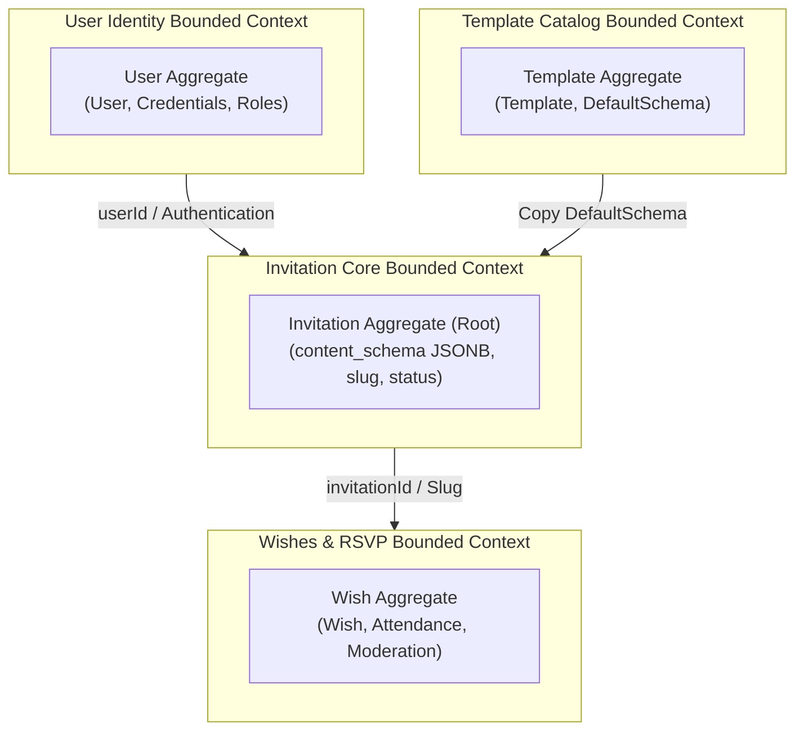
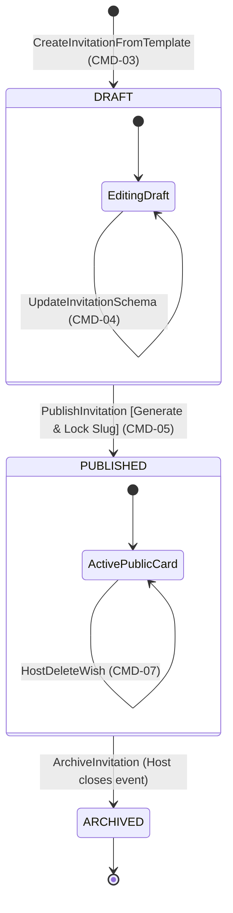

# 🌪️ Event Storming & Domain Model (DDD)

> **Dự án:** Nền tảng Tạo và Chia sẻ Thiệp Mời Sự Kiện Trực Tuyến (JSON-Driven UI)  
> **Tài liệu tham chiếu thượng nguồn (Upstream):** [docs/PRD.md](file:///d:/Programing_Language/InteliJ_IDEA/Thiep-Moi-Project/docs/PRD.md) | [docs/BRD.md](file:///d:/Programing_Language/InteliJ_IDEA/Thiep-Moi-Project/docs/BRD.md) | [docs/scenario.md](file:///d:/Programing_Language/InteliJ_IDEA/Thiep-Moi-Project/docs/scenario.md)  
> **Người thực hiện:** Lead Software Architect & DDD Practitioner  
> **Trạng thái:** Hoàn tất (DoD Certified)

---

## 1. Bounded Contexts & Context Map (Kiến Trúc Modular Monolith)

Hệ thống được thiết kế theo trường phái **Domain-Driven Design (DDD)** với 4 Bounded Contexts hoạt động bên trong một cấu trúc **Modular Monolith** (giao tiếp In-Process thông qua Java Service layer hoặc Spring ApplicationEvents):

### Phân định trách nhiệm từng Context:
1. **User Identity Context:** Quản lý vòng đời tài khoản người dùng, băm mật khẩu và cơ chế cấp phát JWT token.
2. **Template Catalog Context:** Quản lý kho mẫu thiệp mặc định, hỗ trợ việc khởi tạo mẫu sẵn (`Data Seeding`).
3. **Invitation Core Context:** Trung tâm kiến trúc JSON-Driven UI: Quản lý vòng đời thiệp, lưu trữ cây `JSONB`, kiểm soát tính bất biến của `slug` và sinh mã định danh khi xuất bản.
4. **Wishes & RSVP Context:** Quản lý các tương tác của khách mời (lời chúc, xác nhận tham dự), bảo vệ chống spam (Rate Limiting) và tổng hợp số liệu cho chủ thiệp.

---

## 2. Domain Events (`EVT-xx`)

Tất cả các sự kiện miền đều được đặt tên ở **thì quá khứ**, thể hiện một sự kiện nghiệp vụ bất biến đã xảy ra trong hệ thống:

| ID | Tên Sự Kiện (Past Tense) | Context Sở Hữu | Lệnh Sinh Ra Sự Kiện (Trigger Command) | Bên Tiêu Thụ Hạ Nguồn (Consumers) | Truy Vết PRD |
|:---|:---|:---|:---|:---|:---|
| `EVT-01` | `UserRegistered` | User Identity | `CMD-01` (`RegisterUser`) | AuditLogger, WelcomeNotification | `FR-01` |
| `EVT-02` | `UserLoggedIn` | User Identity | `CMD-02` (`LoginUser`) | SecurityTracker, SessionManager | `FR-02` |
| `EVT-03` | `InvitationCreatedFromTemplate` | Invitation Core | `CMD-03` (`CreateInvitationFromTemplate`) | DashboardService | `FR-04` |
| `EVT-04` | `InvitationSchemaUpdated` | Invitation Core | `CMD-04` (`UpdateInvitationSchema`) | LivePreviewRenderer, CacheInvalidator | `FR-05`, `FR-06` |
| `EVT-05` | `InvitationPublished` | Invitation Core | `CMD-05` (`PublishInvitation`) | SlugRegistrar, OpenGraphGenerator | `FR-08` |
| `EVT-06` | `WishSubmitted` | Wishes & RSVP | `CMD-06` (`SubmitWish`) | RsvpCounterPolicy, PublicCardStream | `FR-10` |
| `EVT-07` | `WishDeleted` | Wishes & RSVP | `CMD-07` (`DeleteWish`) | RsvpCounterPolicy | `FR-11` |
| `EVT-08` | `RsvpReportExported` | Wishes & RSVP | `CMD-08` (`ExportRsvpReport`) | AuditLogger | `FR-11` |

---

## 3. Actors & Commands (`CMD-xx`)

Các lệnh thể hiện ý định hành vi của tác nhân hệ thống được viết ở dạng **động từ mệnh lệnh (Imperative)**:

| ID | Tên Lệnh (Imperative) | Tác Nhân Khởi Tạo (Initiator) | Tiền Điều Kiện Nghiệp Vụ (Preconditions) | Sự Kiện Phát Ra (Emits Events) |
|:---|:---|:---|:---|:---|
| `CMD-01` | `RegisterUser` | `ROLE-GUEST` | Email chưa từng tồn tại; mật khẩu $\ge 8$ ký tự | `EVT-01` |
| `CMD-02` | `LoginUser` | `ROLE-GUEST` | Tài khoản tồn tại; mật khẩu băm trùng khớp | `EVT-02` |
| `CMD-03` | `CreateInvitationFromTemplate` | `ROLE-HOST` | `templateId` tồn tại trong kho mẫu; phiên JWT hợp lệ | `EVT-03` |
| `CMD-04` | `UpdateInvitationSchema` | `ROLE-HOST` | `userId` trùng với chủ sở hữu thiệp; JSON không chứa chuỗi Base64 | `EVT-04` |
| `CMD-05` | `PublishInvitation` | `ROLE-HOST` | `userId` trùng với chủ sở hữu; trạng thái thiệp là `DRAFT` hoặc `PUBLISHED` | `EVT-05` |
| `CMD-06` | `SubmitWish` | `ROLE-GUEST` | IP chưa vượt quá 5 requests/phút; Tên $\le 50$, Lời chúc $\le 500$ ký tự | `EVT-06` |
| `CMD-07` | `DeleteWish` | `ROLE-HOST` | `userId` phải là chủ sở hữu của thiệp chứa lời chúc đó | `EVT-07` |
| `CMD-08` | `ExportRsvpReport` | `ROLE-HOST` | `userId` sở hữu thiệp; có ít nhất 0 bản ghi lời chúc/RSVP | `EVT-08` |

---

## 4. Business Policies (`POL-xx` - Quy Tắc Phản Ứng Nghiệp Vụ)

| ID | Mệnh Đề Phản Ứng (Policy Statement) | Sự Kiện Kích Hoạt | Lệnh Kế Tiếp Thực Thi | Phạm Vi (Scope) |
|:---|:---|:---|:---|:---|
| `POL-01` | **Whenever** `InvitationPublished` lần đầu (chưa có slug) **then** sinh chuỗi định danh duy nhất và khóa bất biến (`LockSlugImmutability`) | `EVT-05` | `CMD-05` | In-Process Event |
| `POL-02` | **Whenever** `WishSubmitted` hoặc `WishDeleted` **then** cập nhật bộ đếm tổng hợp sĩ số khách mời (`RecalculateRsvpSummary`) | `EVT-06`, `EVT-07` | Nội bộ Aggregate | In-Process Event |
| `POL-03` | **Whenever** `ApplicationStarted` (Hệ thống khởi chạy) và bảng mẫu rỗng **then** nạp sẵn 3 bộ JSON mẫu mặc định (`SeedDefaultTemplates`) | Khởi chạy App | `AutoSeedCommand` | System Scheduler |

---

## 5. Aggregates & Invariants (`AGG-xx` - Ranh Giới Tính Nhất Quán)

### `[AGG-01]` UserAggregate
- **Root Entity:** `User` (`id`, `email`, `passwordHash`, `fullName`, `createdAt`)
- **Ranh giới tính nhất quán:** Một tài khoản duy nhất định danh bằng địa chỉ email.
- **Bất biến nghiệp vụ (Invariants):**
  - Email là duy nhất trên toàn hệ thống (không phân biệt hoa thường).
  - Mật khẩu lưu trữ bắt buộc phải được mã hóa một chiều qua thuật toán BCrypt.
- **Commands tiếp nhận:** `CMD-01` (`RegisterUser`), `CMD-02` (`LoginUser`).
- **Events phát ra:** `EVT-01` (`UserRegistered`), `EVT-02` (`UserLoggedIn`).

---

### `[AGG-02]` TemplateAggregate
- **Root Entity:** `Template` (`id`, `name`, `thumbnailUrl`, `category`, `defaultSchema`, `createdAt`)
- **Ranh giới tính nhất quán:** Bản ghi mẫu giao diện chuẩn cho người dùng chọn.
- **Bất biến nghiệp vụ (Invariants):**
  - Cột `defaultSchema` (`JSONB`) bắt buộc phải chứa đầy đủ 4 khối tối thiểu: `HERO`, `COUNTDOWN`, `LOCATION`, `WISHES`.
  - Mẫu đã lưu trong hệ thống là tài nguyên Read-only đối với người dùng cuối (`ROLE-HOST`).
- **Commands tiếp nhận:** Khởi tạo dữ liệu mẫu từ hệ thống.

---

### `[AGG-03]` InvitationAggregate (Aggregate Cốt Lõi)
- **Root Entity:** `Invitation` (`id`, `slug`, `userId`, `status`, `contentSchema`, `publishedAt`, `createdAt`, `updatedAt`)
- **Ranh giới tính nhất quán (Consistency Boundary):** Toàn bộ trạng thái và cây cấu trúc JSON-Driven UI của một chiếc thiệp.
- **Bất biến nghiệp vụ (Invariants):**
  - Mọi thiệp bắt buộc phải gắn với một `userId` hợp lệ.
  - Sau khi xuất bản lần đầu (`status = PUBLISHED`), giá trị `slug` được **cố định vĩnh viễn**; các lần cập nhật sau không được phép thay đổi giá trị `slug` này.
  - Toàn bộ cây dữ liệu `contentSchema` phải tuân thủ định dạng chuẩn (`PageSchema`), tuyệt đối cấm chứa chuỗi ảnh Base64 (`data:image/`).
- **Commands tiếp nhận:** `CMD-03` (`CreateInvitationFromTemplate`), `CMD-04` (`UpdateInvitationSchema`), `CMD-05` (`PublishInvitation`).
- **Events phát ra:** `EVT-03`, `EVT-04`, `EVT-05`.

---

### `[AGG-04]` WishAggregate
- **Root Entity:** `Wish` (`id`, `invitationId`, `senderName`, `attendance`, `message`, `createdAt`)
- **Ranh giới tính nhất quán:** Một bản ghi lời chúc mừng kèm trạng thái phản hồi tham dự của khách mời.
- **Bất biến nghiệp vụ (Invariants):**
  - Lời chúc bắt buộc phải thuộc về một `invitationId` tồn tại.
  - Trường `attendance` bắt buộc phải là một trong 2 giá trị hợp lệ: `ATTENDING` hoặc `DECLINED`.
  - Độ dài `senderName` $\le 50$ ký tự, `message` $\le 500$ ký tự.
- **Commands tiếp nhận:** `CMD-06` (`SubmitWish`), `CMD-07` (`DeleteWish`), `CMD-08` (`ExportRsvpReport`).
- **Events phát ra:** `EVT-06`, `EVT-07`, `EVT-08`.

---

## 6. Sơ Đồ Vòng Đời Trạng Thái (State Machine Diagram)

Vòng đời phát triển và xuất bản của một chiếc thiệp mời (`InvitationAggregate`):

### Bảng chuyển dịch trạng thái (State Transition Table):

| Trạng Thái Hiện Tại | Sự Kiện Kích Hoạt | Điều Kiện Chặn (Guard Conditions) | Trạng Thái Mới | Hành Vi Nghiệp Vụ Kèm Theo |
|:---|:---|:---|:---|:---|
| `[None]` | `CMD-03` (Tạo từ mẫu) | `templateId` hợp lệ, user đã đăng nhập | `DRAFT` | Sao chép JSON từ mẫu sang `contentSchema`, sinh `invitationId` |
| `DRAFT` | `CMD-04` (Sửa nội dung) | `userId` sở hữu thiệp, URL ảnh hợp lệ | `DRAFT` | Cập nhật cây `contentSchema` vào JSONB, cập nhật `updatedAt` |
| `DRAFT` | `CMD-05` (Xuất bản) | Cấu trúc JSON đầy đủ 4 khối cơ bản | `PUBLISHED` | Sinh `slug` duy nhất, gán `publishedAt = NOW()`, khóa slug vĩnh viễn |
| `PUBLISHED` | `CMD-04` (Sửa sau xuất bản)| `userId` sở hữu thiệp | `PUBLISHED` | Cập nhật `contentSchema`, **giữ nguyên giá trị `slug` cũ** |
| `PUBLISHED` | `CMD-09` (Đóng sự kiện) | Chủ thiệp xác nhận đóng thiệp | `ARCHIVED` | Ngừng nhận lời chúc mới, ẩn khỏi link công khai |

---

## 7. Glossary (Ubiquitous Language - Thuật Ngữ Nghiệp Vụ Thống Nhất)

Để đảm bảo toàn bộ đội ngũ lập trình viên, BA và Tester hiểu chung một khái niệm duy nhất, quy chuẩn bảng ngôn ngữ sau:

| Thuật Ngữ Chuẩn (Domain Term) | Ý Nghĩa Nghiệp Vụ Thống Nhất | Các Từ Đồng Nghĩa Bị Loại Bỏ (Rejected Synonyms) |
|:---|:---|:---|
| **Invitation** | Bản ghi thiệp mời hoàn chỉnh do người dùng tạo và xuất bản | Card, E-card, Thiệp cưới, Post |
| **PageSchema** | Toàn bộ cây dữ liệu JSON định nghĩa cấu trúc, theme và nội dung của thiệp | UI JSON, Config, Schema Tree, Template Data |
| **UIBlock** | Một khối thành phần giao diện độc lập (Hero, Countdown, Location, Wishes) | Section, Component, Row, Khối giao diện |
| **Slug** | Chuỗi định danh ngắn gọn duy nhất tạo nên URL thân thiện cho thiệp (VD: `/t/tuan-mai`) | Shortlink, Identifier, URL Path, Mã thiệp |
| **Wishes** | Bản ghi lời chúc mừng kèm phản hồi tham dự do khách gửi vào thiệp | Guestbook, Comment, Phản hồi, Lời nhắn |
| **RSVP** | Hành động khách mời xác nhận có tham dự sự kiện hay không (`ATTENDING`/`DECLINED`)| Điểm danh, Xác nhận, Tham dự |
| **STACK Mode** | Cơ chế sắp xếp các khối giao diện theo chiều dọc từ trên xuống dưới | Vertical Flow, Cuộn dọc, Xếp chồng |

---

## ✅ Definition of Done (DoD) - Event Storming

- [x] **100% Domain Events (`EVT-01` đến `EVT-08`)** đều được đặt tên ở thì quá khứ, sở hữu bởi đúng 1 Bounded Context duy nhất và không bị trùng lặp. *(Bằng chứng: 8/8 EVTs tại Mục 2)*
- [x] **Mọi Command (`CMD-01` đến `CMD-08`)** đều gắn với Actor hoặc Policy cụ thể, có tiền điều kiện rõ ràng và phát ra Event tương ứng. *(Bằng chứng: Bảng Commands tại Mục 3)*
- [x] **Xác định rõ 4 Aggregate Roots** (`User`, `Template`, `Invitation`, `Wish`) kèm các Invariants bất biến trong 1 transaction; sơ đồ State Machine mô tả vòng đời trọn vẹn từ `DRAFT` $\rightarrow$ `PUBLISHED` $\rightarrow$ `ARCHIVED` không có trạng thái mồ côi. *(Bằng chứng: Mục 5 và Mục 6)*
- [x] **100% Yêu cầu chức năng (`FR-01` đến `FR-12`)** từ PRD đều được hiện thực hóa qua chuỗi tương tác Command $\rightarrow$ Aggregate $\rightarrow$ Event. *(Bằng chứng: Cột Traces To tại Mục 2 và Mục 3)*
- [x] **Không có Aggregate nào bị phân tách đôi giữa 2 Contexts.** *(Bằng chứng: Context Map tại Mục 1)*
