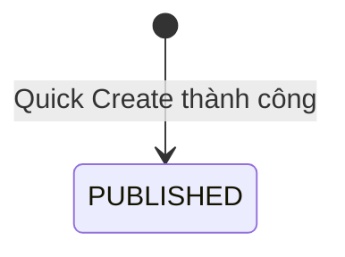

# Event Storming và mô hình miền

> Baseline mã nguồn `679cc41`. Sự kiện dưới đây mô tả kết quả nghiệp vụ quan sát được từ lời gọi đồng bộ. Xem [PRD](PRD.md) và [ADD](ADD.md).

## 1. Ranh giới miền

| Context ID | Context | Dữ liệu sở hữu và điểm bàn giao |
|---|---|---|
| `BC-01` | Identity | Tài khoản, token xác minh và refresh token. Chuyển danh tính đã xác thực cho Quick Create khi có phiên |
| `BC-02` | Template Catalog & Studio | Mẫu, mã mẫu, schema mặc định. Cung cấp mẫu cho preview và cá nhân hóa |
| `BC-03` | Invitation | Snapshot thiệp đã cá nhân hóa, slug và thông tin sự kiện. Cung cấp bản ghi thiệp cho sổ lưu bút theo slug |
| `BC-04` | Wishes & RSVP | Lời chúc và phản hồi thuộc một thiệp. Phục vụ danh sách theo slug và phân trang |

## 2. Lệnh và kết quả

| Command ID | Tác nhân và điều kiện | Kết quả | Truy vết | Hiện trạng |
|---|---|---|---|---|
| `CMD-01` | Người dùng đăng ký bằng thông tin hợp lệ | `EVT-01` | `FR-01` | Đã có |
| `CMD-02` | Người dùng đủ điều kiện đăng nhập và dùng đúng mật khẩu | `EVT-02` | `FR-02` | Đã có |
| `CMD-03` | Khách hoặc người đã đăng nhập gửi dữ liệu cưới và schema từ luồng chọn mẫu | `EVT-03`, `EVT-05` | `FR-04`, `FR-08` | Quick Create lưu và xuất bản trong một lần ghi |
| `CMD-04` | Chủ thiệp hợp lệ yêu cầu cập nhật schema của thiệp đã lưu | `EVT-04` | `FR-05`, `FR-06` | Dự kiến. Preview hiện cập nhật trạng thái cục bộ |
| `CMD-05` | Chủ thiệp xác nhận xuất bản bản nháp | `EVT-05` | `FR-08` | Dự kiến dưới dạng lệnh riêng. Hiện `CMD-03` tạo thiệp đã xuất bản |
| `CMD-06` | Khách gửi tên, RSVP và lời chúc hợp lệ cho slug đã có | `EVT-06` | `FR-10` | Đã có. Từ chối nếu dữ liệu sai hoặc slug không tồn tại |
| `CMD-07` | Chủ thiệp xóa lời chúc thuộc thiệp của mình | `EVT-07` | `FR-11` | Dự kiến |
| `CMD-08` | Chủ thiệp yêu cầu tải báo cáo RSVP | `EVT-08` | `FR-11` | Dự kiến |
| `CMD-09` | Chủ thiệp yêu cầu lưu trữ thiệp đã xuất bản | Chuyển sang `ARCHIVED` | `FR-08` | Dự kiến, cần chốt hành vi của link công khai |
| `CMD-10` | Studio tạo, clone hoặc sửa mẫu với dữ liệu hợp lệ | `EVT-09` | `FR-13` | Đã có. Tạo và clone từ chối code trùng |

| Event ID | Kết quả nghiệp vụ | Context |
|---|---|---|
| `EVT-01` | `UserRegistered` – Tài khoản được tạo để xác minh email | `BC-01` |
| `EVT-02` | `UserLoggedIn` – Tài khoản nhận phiên đăng nhập | `BC-01` |
| `EVT-03` | `InvitationCreatedFromTemplate` – Snapshot cá nhân hóa được lưu | `BC-03` |
| `EVT-04` | `InvitationSchemaUpdated` – Schema thiệp đã lưu được thay đổi, dự kiến | `BC-03` |
| `EVT-05` | `InvitationPublished` – Thiệp có slug và có thể mở công khai | `BC-03` |
| `EVT-06` | `WishSubmitted` – Phản hồi được lưu vào sổ lưu bút của thiệp | `BC-04` |
| `EVT-07` | `WishDeleted` – Chủ thiệp đã xóa lời chúc, dự kiến | `BC-04` |
| `EVT-08` | `RsvpReportExported` – Chủ thiệp đã nhận báo cáo, dự kiến | `BC-04` |
| `EVT-09` | Mẫu được tạo, nhân bản hoặc cập nhật | `BC-02` |

## 3. Chính sách và aggregate

| Policy ID | Chính sách |
|---|---|
| `POL-01` | Quick Create sinh slug trước khi ghi, thêm hậu tố khi tên cơ sở đã tồn tại. Cơ sở dữ liệu áp đặt unique slug. Luồng cập nhật tương lai phải giữ slug theo `BR-02` |
| `POL-02` | Tổng hợp sĩ số RSVP là chức năng dự kiến của màn hình chủ thiệp. Hiện truy vấn trả danh sách phân trang, với số người được chuẩn hóa từng phản hồi |
| `POL-03` | Khi khởi động, `TemplateService.seedInitialTemplates` xử lý ba mã mẫu cưới. Minimalism và Song Hỷ Xanh được thêm khi thiếu code. HB04 có nhánh cập nhật dữ liệu mẫu cũ |

| Aggregate ID | Aggregate và bất biến |
|---|---|
| `AGG-01` | User. Email duy nhất, xác minh email trước đăng nhập, token có hạn sử dụng |
| `AGG-02` | Template. Code duy nhất, bản clone có thể tham chiếu mẫu nguồn. Renderer package được chọn theo binding trong schema |
| `AGG-03` | Invitation. Slug duy nhất, schema đã cá nhân hóa lưu cùng thông tin sự kiện. `userId` có thể rỗng khi tạo ẩn danh |
| `AGG-04` | Wish. Phản hồi phải thuộc thiệp có thật. `DECLINED` lưu 0 người. `ATTENDING` và `MAYBE` lưu tối thiểu 1 |

## 4. Vòng đời thiệp

Enum lưu trữ còn có `DRAFT` và `ARCHIVED`. Chuyển trạng thái nháp, xuất bản riêng và lưu trữ thuộc backlog. API đọc thiệp và API lời chúc hiện chỉ tìm theo slug. Nếu sau này ghi thêm trạng thái, phải quy định trạng thái nào được đọc, trạng thái nào được gửi lời chúc và dữ liệu cũ xử lý ra sao.

## 5. Truy vấn và read model

| Query ID | Truy vấn hoặc tương tác | Nguồn dữ liệu | Truy vết |
|---|---|---|---|
| `QRY-01` | Danh sách mẫu đã xuất bản và chi tiết mẫu | Template repository | `FR-03`, `FR-04` |
| `QRY-02` | Preview theo package và version | Schema và form state phía client | `FR-05`, `FR-06`, `FR-07` |
| `QRY-03` | Xem thiệp theo slug | Invitation repository. Frontend có fallback theo slug | `FR-09` |
| `QRY-04` | Đọc sổ lưu bút mới nhất trước | Wish repository theo ID thiệp | `FR-10` |
| `QRY-05` | Đọc metadata theo slug cho crawler | Dự kiến lấy từ snapshot thiệp | `FR-12` |
