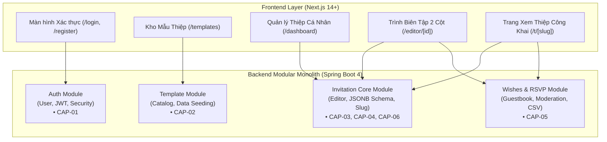
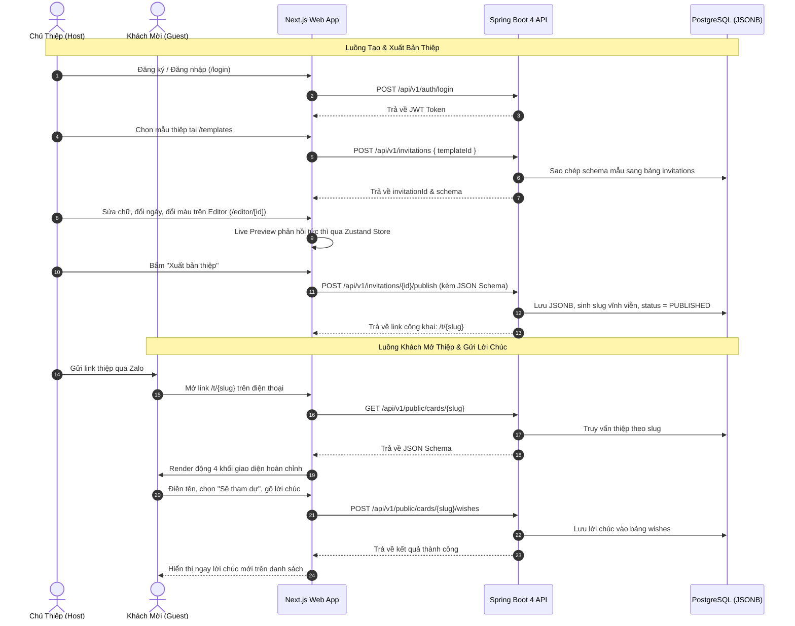

# 📦 Product Requirements Document (PRD)

> **Dự án:** Nền tảng Tạo và Chia sẻ Thiệp Mời Sự Kiện Trực Tuyến (JSON-Driven UI)  
> **Tài liệu tham chiếu thượng nguồn (Upstream):** [docs/BRD.md](file:///d:/Programing_Language/InteliJ_IDEA/Thiep-Moi-Project/docs/BRD.md) | [docs/scenario.md](file:///d:/Programing_Language/InteliJ_IDEA/Thiep-Moi-Project/docs/scenario.md) | [docs/source_facts.md](file:///d:/Programing_Language/InteliJ_IDEA/Thiep-Moi-Project/docs/source_facts.md)  
> **Người thực hiện:** Lead Software Architect & Product Owner  
> **Trạng thái:** Hoàn tất (DoD Certified)

---

## 1. Domain Capabilities & Candidate Boundaries (Phân Định Ranh Giới Module)

Hệ thống được tổ chức theo kiến trúc **Modular Monolith** trên nền Spring Boot 4 + Next.js, gom nhóm các năng lực nghiệp vụ (`CAP-xx`) từ BRD thành 4 Module nghiệp vụ độc lập:

### Chi tiết các Module ứng viên:
1. **Module 1: `auth-module` (`CAP-01`):** Quản lý định danh tài khoản người dùng, băm mật khẩu BCrypt, cấp phát và xác thực JWT token.
2. **Module 2: `template-module` (`CAP-02`):** Quản lý danh mục mẫu thiệp JSON có sẵn trong Database, hỗ trợ cơ chế tự động nạp dữ liệu mẫu (*Auto-seeding*).
3. **Module 3: `invitation-module` (`CAP-03`, `CAP-04`, `CAP-06`):** Trái tim của hệ thống JSON-Driven UI. Quản lý trạng thái thiệp, lưu trữ cây giao diện vào cột PostgreSQL `JSONB`, cấp phát và bảo vệ tính bất biến của `slug`, cung cấp API render động cho Frontend.
4. **Module 4: `wishes-rsvp-module` (`CAP-05`):** Xử lý luồng khách mời gửi lời chúc và xác nhận tham dự (`ATTENDING`/`DECLINED`), kiểm soát Rate Limiting chống spam và cung cấp công cụ kiểm duyệt, xuất dữ liệu cho chủ thiệp.

---

## 2. Functional Requirements (User Stories & Acceptance Criteria)

### `[FR-01]` Đăng ký Tài khoản Người dùng
- **User Story:** Là một `[ROLE-GUEST]`, tôi muốn đăng ký tài khoản bằng Email và Mật khẩu để có thể lưu trữ và quản lý các mẫu thiệp tôi tạo ra.
- **Priority:** High (Must) | **Traces to:** `CAP-01`
- **Inputs:** `email` (string, format email), `password` (string, $\ge 8$ ký tự), `fullName` (string).
- **Outputs:** Thông báo đăng ký thành công và chuyển hướng sang trang Đăng nhập.
- **Acceptance Criteria (AC):**
  - **Happy Path:** Given người dùng nhập email chưa tồn tại và mật khẩu thỏa mãn độ dài, When bấm "Đăng ký", Then hệ thống băm mật khẩu bằng BCrypt, lưu tài khoản vào DB và trả về mã HTTP `201 Created` kèm thông báo thành công.
  - **Edge / Error Case:** Given email đã được sử dụng bởi một tài khoản khác, When bấm "Đăng ký", Then hệ thống từ chối tạo mới, trả về mã HTTP `409 Conflict` kèm thông báo *"Email này đã được đăng ký trong hệ thống"*.

---

### `[FR-02]` Đăng nhập & Cấp phát Phiên làm việc (JWT Token)
- **User Story:** Là một `[ROLE-HOST]`, tôi muốn đăng nhập bằng tài khoản của mình để truy cập vào trình chỉnh sửa thiệp cá nhân.
- **Priority:** High (Must) | **Traces to:** `CAP-01`
- **Inputs:** `email` (string), `password` (string).
- **Outputs:** Mã `accessToken` (JWT), `userInfo` (`id`, `email`, `fullName`).
- **Acceptance Criteria (AC):**
  - **Happy Path:** Given người dùng nhập đúng email và mật khẩu, When bấm "Đăng nhập", Then hệ thống sinh JWT chứa `userId` và `role`, trả về mã `200 OK`, Frontend lưu token vào cookie/localStorage an toàn.
  - **Edge / Error Case:** Given người dùng nhập sai mật khẩu quá 5 lần liên tiếp, When bấm "Đăng nhập", Then hệ thống trả về mã `401 Unauthorized` kèm thông báo an toàn *"Email hoặc mật khẩu không chính xác"*.

---

### `[FR-03]` Xem Kho Mẫu Thiệp Mặc Định
- **User Story:** Là một `[ROLE-HOST]`, tôi muốn duyệt xem danh sách các mẫu thiệp có sẵn để chọn một mẫu phù hợp với phong cách đám cưới/sự kiện của mình.
- **Priority:** High (Must) | **Traces to:** `CAP-02`
- **Inputs:** Không yêu cầu.
- **Outputs:** Danh sách các mẫu thiệp (`id`, `name`, `thumbnailUrl`, `category`).
- **Acceptance Criteria (AC):**
  - **Happy Path:** Given người dùng truy cập trang `/templates`, When trang tải xong, Then hệ thống hiển thị danh sách tối thiểu 3 mẫu thiệp (`Minimalist Wedding`, `Vintage Floral`, `Birthday Modern`) kèm hình ảnh xem trước sắc nét.
  - **Edge / Error Case:** Given cơ sở dữ liệu chưa có mẫu nào, When gọi API `GET /api/v1/templates`, Then hệ thống kích hoạt cơ chế Data Seeding tự động tạo 3 mẫu mặc định và trả về danh sách mà không bị lỗi trang trống.

---

### `[FR-04]` Khởi Tạo Thiệp Mới Từ Mẫu Đã Chọn
- **User Story:** Là một `[ROLE-HOST]`, tôi muốn bấm "Sử dụng mẫu này" để hệ thống tự động nhân bản cấu trúc JSON của mẫu sang một thiệp riêng của tôi.
- **Priority:** High (Must) | **Traces to:** `CAP-02`, `CAP-03`
- **Inputs:** `templateId` (UUID).
- **Outputs:** `invitationId` (UUID) và chuyển hướng tới `/editor/[id]`.
- **Acceptance Criteria (AC):**
  - **Happy Path:** Given người dùng đã đăng nhập và chọn một `templateId` hợp lệ, When bấm nút "Sử dụng mẫu này", Then hệ thống sao chép `default_schema` sang bảng `invitations` gán với `user_id` hiện tại, trả về `invitationId` và mở màn hình Editor.
  - **Edge / Error Case:** Given người dùng chưa đăng nhập, When bấm nút "Sử dụng mẫu này", Then hệ thống chuyển hướng người dùng sang trang Đăng nhập kèm tham số chuyển tiếp `?redirect=/editor/[id]`.

---

### `[FR-05]` Chỉnh Sửa Thuộc Tính Khối & Theme (Live Editor)
- **User Story:** Là một `[ROLE-HOST]`, tôi muốn chỉnh sửa tên cô dâu chú rể, ngày giờ, địa điểm Google Maps, đổi font chữ và màu sắc để thấy giao diện thiệp đổi ngay lập tức bên cột điện thoại.
- **Priority:** High (Must) | **Traces to:** `CAP-03`, `BR-01`, `BR-03`, `BR-06`
- **Inputs:** `blockId`, các trường thông tin trong `props` (tên, ngày, địa chỉ, URL ảnh), `theme` (`primaryColor`, `headingFont`, `bodyFont`).
- **Outputs:** Khung Phone Live Preview bên phải tự động cập nhật lại giao diện sau mỗi ký tự gõ mà không cần tải lại trang.
- **Acceptance Criteria (AC):**
  - **Happy Path:** Given chủ thiệp đang ở màn hình Editor, When gõ chữ đổi tên cặp đôi ở cột trái, Then Zustand store cập nhật State và `PageRenderer` bên cột phải dựng lại chữ mới trong vòng dưới $50$ms.
  - **Edge / Error Case (Vi phạm Base64):** Given người dùng cố tình dán chuỗi Base64 (`data:image/png;base64,...`) vào ô link ảnh, When blur khỏi ô input, Then hệ thống báo lỗi đỏ *"Chỉ chấp nhận link ảnh URL hợp lệ (http/https). Vui lòng không dán mã Base64"* và chặn không cập nhật vào JSON.

---

### `[FR-06]` Thay Đổi Thứ Tự Khối Giao Diện (STACK Mode)
- **User Story:** Là một `[ROLE-HOST]`, tôi muốn bấm nút Mũi tên Lên/Xuống ở từng khối để hoán đổi vị trí của các khối trong thiệp.
- **Priority:** High (Must) | **Traces to:** `CAP-03`
- **Inputs:** `blockId`, hành động (`MOVE_UP` hoặc `MOVE_DOWN`).
- **Outputs:** Mảng `blocks` trong State JSON thay đổi vị trí index tương ứng, cột Live Preview đổi vị trí khối ngay lập tức.
- **Acceptance Criteria (AC):**
  - **Happy Path:** Given khối `LocationBlock` đang nằm dưới khối `CountdownBlock`, When bấm nút "Di chuyển Lên" tại `LocationBlock`, Then `LocationBlock` đảo lên vị trí phía trên `CountdownBlock` trên cả Form và Live Preview.
  - **Edge / Error Case:** Given khối đang ở vị trí đầu tiên của danh sách, When xem trên giao diện, Then nút "Di chuyển Lên" bị vô hiệu hóa (disabled) để tránh lỗi thao tác.

---

### `[FR-07]` Dựng Hình Động 4 Khối Cốt Lõi (JSON-Driven UI Engine)
- **User Story:** Là một `[ROLE-HOST]` hoặc `[ROLE-GUEST]`, tôi muốn 4 khối (`Hero`, `Countdown`, `Location`, `Wishes`) hiển thị đẹp mắt, tương thích hoàn hảo trên điện thoại.
- **Priority:** High (Must) | **Traces to:** `CAP-04`, `BR-06`
- **Inputs:** Cây JSON Schema hợp lệ chứa mảng `blocks`.
- **Outputs:** Giao diện điện thoại hoàn chỉnh gồm ảnh bìa, đồng hồ đếm ngược chạy từng giây, nút mở bản đồ Google Maps và form gửi lời chúc.
- **Acceptance Criteria (AC):**
  - **Happy Path:** Given JSON Schema hợp lệ, When `PageRenderer` duyệt mảng blocks, Then `ComponentRegistry` nạp đúng từng React component tương ứng và hiển thị đầy đủ thông tin.
  - **Edge / Error Case (Link ảnh chết):** Given link ảnh bìa trong `HeroBlock` bị lỗi 404, When component tải ảnh, Then sự kiện `onError` tự động kích hoạt thay thế bằng ảnh placeholder mặc định trang nhã, không làm vỡ khung thiệp.

---

### `[FR-08]` Lưu Bản Nháp & Xuất Bản Thiệp (Immutable Slug)
- **User Story:** Là một `[ROLE-HOST]`, tôi muốn bấm "Xuất bản" để nhận link công khai chia sẻ cho bạn bè, và khi tôi sửa lại nội dung sau đó thì link này vẫn không bị đổi.
- **Priority:** High (Must) | **Traces to:** `CAP-06`, `BR-01`, `BR-02`
- **Inputs:** `PageSchema` hiện tại trong Editor.
- **Outputs:** Trạng thái chuyển sang `PUBLISHED`, sinh link chia sẻ dạng `https://.../t/{slug}`.
- **Acceptance Criteria (AC):**
  - **Happy Path:** Given thiệp đang ở trạng thái `DRAFT`, When bấm "Xuất bản", Then hệ thống sinh chuỗi `slug` ngẫu nhiên duy nhất, lưu JSON vào cột `content_schema` (`JSONB`), chuyển status sang `PUBLISHED` và hiện modal chúc mừng kèm link rút gọn.
  - **Edge / Error Case (Sửa đổi sau xuất bản):** Given thiệp đã xuất bản và đã có `slug = "tuan-mai-wedding"`, When chủ thiệp sửa lại giờ tổ chức và bấm "Lưu cập nhật", Then hệ thống cập nhật `content_schema` và `updated_at`, nhưng giá trị `slug` vẫn giữ nguyên là `"tuan-mai-wedding"`.

---

### `[FR-09]` Mở Thiệp Công Khai Qua Đường Dẫn Rút Gọn
- **User Story:** Là một `[ROLE-GUEST]`, tôi muốn bấm vào liên kết `/t/{slug}` trên điện thoại để xem nội dung thiệp cưới nhanh chóng mà không cần đăng nhập.
- **Priority:** High (Must) | **Traces to:** `CAP-06`, `BR-06`
- **Inputs:** `slug` (string trên URL).
- **Outputs:** Toàn bộ thiệp mời được vẽ ra trên màn hình điện thoại của khách mời.
- **Acceptance Criteria (AC):**
  - **Happy Path:** Given khách truy cập link hợp lệ, When trang tải, Then Frontend gọi API `GET /api/v1/public/cards/{slug}`, nhận về JSON và vẽ ra thiệp mượt mà dưới 1.2 giây trên mạng 4G.
  - **Edge / Error Case:** Given khách nhập sai đường dẫn hoặc thiệp không tồn tại, When trang tải, Then hệ thống hiển thị màn hình 404 thân thiện: *"Rất tiếc, thiệp mời này không tồn tại hoặc đã ngừng chia sẻ"*.

---

### `[FR-10]` Khách Mời Gửi Lời Chúc & Xác Nhận Tham Dự (RSVP)
- **User Story:** Là một `[ROLE-GUEST]`, tôi muốn gửi lời chúc mừng và chọn xem mình có thể đến dự hay không để cô dâu chú rể biết đường chuẩn bị mâm cỗ.
- **Priority:** High (Must) | **Traces to:** `CAP-05`, `BR-04`, `BR-05`
- **Inputs:** `senderName` (string, $\le 50$ ký tự), `attendance` (enum: `ATTENDING` hoặc `DECLINED`), `message` (string, $\le 500$ ký tự).
- **Outputs:** Bản ghi lời chúc được lưu vào DB và hiển thị ngay trên danh sách lời chúc của thiệp.
- **Acceptance Criteria (AC):**
  - **Happy Path:** Given khách điền tên "Nguyễn Văn A", chọn "Sẽ tham dự" và nhập lời chúc, When bấm "Gửi lời chúc", Then hệ thống lưu bản ghi vào bảng `wishes`, trả về `201 Created` và lời chúc mới xuất hiện ngay đầu danh sách kèm huy hiệu "Sẽ tham dự".
  - **Edge / Error Case (Spam Rate Limit):** Given một địa chỉ IP gửi liên tiếp 6 lời chúc trong vòng 60 giây, When bấm gửi ở lần thứ 6, Then hệ thống chặn request, trả về mã HTTP `429 Too Many Requests` kèm thông báo *"Bạn đang thao tác quá nhanh. Vui lòng chờ 1 phút trước khi gửi tiếp"*.

---

### `[FR-11]` Quản Lý Lời Chúc, Xóa Lời Chúc Rác & Xuất Báo Cáo RSVP
- **User Story:** Là một `[ROLE-HOST]`, tôi muốn xem thống kê có bao nhiêu người đi/không đi, xóa các lời chúc khiếm nhã và tải file Excel/CSV danh sách khách mời để báo cỗ cho nhà hàng.
- **Priority:** High (Must) | **Traces to:** `CAP-05`, `BR-01`, `BR-04`
- **Inputs:** `invitationId`, thao tác Xóa (`wishId`) hoặc thao tác Bấm nút "Xuất danh sách (CSV)".
- **Outputs:** Thẻ tổng kết sĩ số (`Tổng số phản hồi`, `Sẽ tham dự: X`, `Không thể đến: Y`), xóa thành công lời chúc hoặc tải về file `.csv` chứa danh sách khách.
- **Acceptance Criteria (AC):**
  - **Happy Path (Xóa lời chúc):** Given chủ thiệp đang mở trang quản lý thiệp của mình, When bấm nút "Xóa" tại một lời chúc có nội dung rác, Then hệ thống xóa bản ghi khỏi DB và cập nhật lại danh sách.
  - **Happy Path (Xuất file CSV):** Given chủ thiệp bấm nút "Xuất CSV", When yêu cầu xử lý, Then trình duyệt tự động tải xuống file `danh-sach-khach-moi-[slug].csv` với định dạng UTF-8 có dấu đầy đủ các cột: Thời gian, Tên khách, Xác nhận tham dự, Lời chúc.
  - **Edge / Error Case:** Given một người dùng khác cố tình gọi API xóa lời chúc mà không phải chủ sở hữu thiệp, When gửi request `DELETE`, Then hệ thống trả về `403 Forbidden` và từ chối xóa.

---

### `[FR-12]` Tối Ưu Thẻ Meta OpenGraph (Chia Sẻ Zalo / Facebook)
- **User Story:** Là một `[ROLE-HOST]` hoặc `[ROLE-GUEST]`, tôi muốn khi dán link thiệp vào khung chat Zalo hay Facebook thì xuất hiện khung xem trước gồm ảnh bìa và tên cặp đôi sắc nét.
- **Priority:** High (Must) | **Traces to:** `CAP-06`
- **Inputs:** Request từ bot cào Zalo / Facebook (User-Agent Zalo, FacebookBot).
- **Outputs:** Trả về thẻ `<meta property="og:title">`, `<meta property="og:image">`, `<meta property="og:description">` được render từ Server (SSR).
- **Acceptance Criteria (AC):**
  - **Happy Path:** Given link `/t/tuan-mai`, When bot của Zalo quét đường dẫn, Then trang trả về tiêu đề *"Thiệp mời cưới: Tuấn & Mai"* cùng ảnh bìa sự kiện, Zalo hiển thị card xem trước đẹp mắt.
  - **Edge / Error Case:** Given thiệp chưa có ảnh bìa hoặc URL ảnh bìa bị lỗi, When render meta tags, Then hệ thống sử dụng ảnh bìa thương hiệu mặc định của hệ thống để không bị ô ảnh trống.

---

## 3. Non-Functional Requirements (NFRs)

| ID | Nhóm NFR | Đặc Tả Yêu Cầu Kỹ Thuật | Chỉ Số Mục Tiêu (Metric & Target) | Phương Pháp Kiểm Chứng |
|:---|:---|:---|:---|:---|
| `NFR-PERF-01` | **Performance** | Thời gian phản hồi Backend P95 cho API đọc thiệp public `/api/v1/public/cards/{slug}` | $\le 150$ ms tại tải 500 CCU | K6 Load Testing script |
| `NFR-PERF-02` | **Performance** | First Contentful Paint (FCP) trang thiệp công khai trên mạng di động 4G | $\le 1.2$ giây; Lighthouse Performance $\ge 90$ | Google Lighthouse / WebPageTest |
| `NFR-PERF-03` | **Performance** | Độ trễ cập nhật Live Preview trên Editor khi người dùng gõ phím | $\le 50$ ms (Zustand reactive state) | Performance Profiler trong Chrome DevTools |
| `NFR-AVAIL-01` | **Availability** | Độ sẵn sàng của API phục vụ khách mở thiệp | $\ge 99.9\%$ Uptime (không quá 43 phút downtime/tháng) | UptimeRobot Monitoring Probe |
| `NFR-SEC-01` | **Security** | Lưu trữ mật khẩu người dùng | Băm bằng **BCrypt** với work factor = 12 | Code Review & Audit |
| `NFR-SEC-02` | **Security** | Xác thực người dùng qua API | JWT (HS256 hoặc RS256, secret key $\ge 256$ bit, hạn 24 giờ) | Security Unit Test & OWASP ZAP |
| `NFR-SEC-03` | **Security** | Chống mã độc XSS trong JSON-Driven UI | Tuyệt đối không dùng `dangerouslySetInnerHTML`, escape toàn bộ HTML | SonarQube Static Analysis |
| `NFR-SEC-04` | **Security** | Phòng chống Spam & DoS API lời chúc | Giới hạn tối đa 5 requests / phút / IP | Rate Limiter Test Suite |
| `NFR-SCAL-01` | **Scalability** | Dung lượng lưu trữ cây JSON Schema | Tối đa $\le 500$ KB mỗi bản ghi JSONB (chặn triệt để Base64) | Database Integrity Assertions |
| `NFR-USAB-01` | **Usability** | Trải nghiệm giao diện di động (Mobile-First) | Tương thích hoàn hảo từ chiều rộng 360px đến 430px | Chrome Device Emulation Testing |
| `NFR-COMP-01` | **Compatibility**| Tương thích trình duyệt nhúng mạng xã hội | Hoạt động mượt mà 100% trên Zalo In-App Browser, Safari iOS, Chrome | Manual Testing trên thiết bị thật |

---

## 4. Roles and Permission Matrix (Ma Trận Phân Quyền)

### Định danh các vai trò hệ thống:
- `ROLE-GUEST`: Khách mời hoặc người dùng vãng lai chưa đăng nhập.
- `ROLE-HOST`: Người tạo thiệp đã đăng ký và xác thực tài khoản qua JWT.
- `ROLE-ADMIN`: Quản trị viên hệ thống có toàn quyền vận hành.

### Bảng Ma trận Phân quyền:

| Mã Tính Năng & Hành Động | `ROLE-GUEST` | `ROLE-HOST` | `ROLE-ADMIN` | Ghi Chú Phân Quyền |
|:---|:---:|:---:|:---:|:---|
| `FR-01`: Đăng ký tài khoản | **Allowed** | Denied | Denied | Đã đăng nhập thì không đăng ký lại |
| `FR-02`: Đăng nhập hệ thống | **Allowed** | Denied | Denied | Đã có phiên thì không đăng nhập lại |
| `FR-03`: Xem kho mẫu thiệp | **Allowed** | **Allowed** | **Allowed** | Công khai cho mọi đối tượng |
| `FR-04`: Khởi tạo thiệp từ mẫu | Denied | **Allowed** | **Allowed** | Yêu cầu phải có tài khoản |
| `FR-05`: Sửa thông tin thiệp trên Editor | Denied | **Conditional** | **Allowed** | Chỉ sửa được thiệp do chính mình tạo ra (`user_id` khớp) |
| `FR-06`: Đổi thứ tự khối (Up/Down) | Denied | **Conditional** | **Allowed** | Chỉ áp dụng với thiệp sở hữu |
| `FR-07`: Dựng hình động 4 khối giao diện | **Allowed** | **Allowed** | **Allowed** | Renderer chạy phía Client |
| `FR-08`: Xuất bản thiệp & Nhận slug | Denied | **Conditional** | **Allowed** | Chỉ chủ thiệp mới được xuất bản |
| `FR-09`: Xem thiệp công khai qua `/t/{slug}` | **Allowed** | **Allowed** | **Allowed** | Công khai cho toàn bộ khách mời |
| `FR-10`: Khách gửi lời chúc & RSVP | **Allowed** | **Allowed** | **Allowed** | Khách chỉ cần điền form, không cần login |
| `FR-11`: Xóa lời chúc rác & Xuất CSV | Denied | **Conditional** | **Allowed** | Chỉ chủ sở hữu thiệp mới có quyền xem & xóa |
| `FR-12`: Thẻ OpenGraph chia sẻ Zalo | **Allowed** | **Allowed** | **Allowed** | Phục vụ crawler mạng xã hội |

---

## 5. UX Requirements & Screen Inventory (Danh Mục Màn Hình & Trạng Thái)

| Mã Màn Hình | Tên Màn Hình & Đường Dẫn | Mục Đích Giao Diện | Vai Trò Cho Phép | Truy Vết FR | Các Trạng Thái Bắt Buộc Xử Lý |
|:---|:---|:---|:---|:---|:---|
| `SCR-01` | **Màn hình Xác thực** (`/login`, `/register`) | Đăng ký tài khoản mới và đăng nhập nhận JWT token | `ROLE-GUEST` | `FR-01`, `FR-02` | `Loading` (khi gửi API), `Error` (sai thông tin) |
| `SCR-02` | **Kho Mẫu Thiệp** (`/templates` hoặc `/`) | Hiển thị 3 mẫu thiệp kèm nút xem thử và nút "Sử dụng mẫu này" | Tất cả Roles | `FR-03`, `FR-04` | `Loading` (Skeleton card), `Empty` (chưa có mẫu) |
| `SCR-03` | **Quản Lý Thiệp Cá Nhân** (`/dashboard`) | Danh sách thiệp đã tạo, trạng thái Draft/Published, link chia sẻ | `ROLE-HOST` | `FR-08`, `FR-11` | `Loading`, `Empty` (chưa tạo thiệp nào), `Error` |
| `SCR-04` | **Trình Biên Tập Hai Cột** (`/editor/[id]`) | Cột trái là Form controls và Theme picker; Cột phải là Phone Live Preview | `ROLE-HOST` | `FR-05`, `FR-06`, `FR-08`, `FR-11` | `Loading`, `Error` (lỗi tải schema), `Forbidden` (không phải chủ thiệp) |
| `SCR-05` | **Trang Thiệp Công Khai** (`/t/[slug]`) | Khung hiển thị thiệp mời tối ưu di động cho khách xem và gửi lời chúc | Tất cả Roles | `FR-07`, `FR-09`, `FR-10`, `FR-12` | `Loading` (Skeleton thiệp), `Error` (404 không tìm thấy), `Success` (sau khi gửi wish) |

### Sơ đồ Luồng Trải Nghiệm Người Dùng (User Flows)

---

## 6. Open Questions (Câu Hỏi Kỹ Thuật Đang Mở)

| Mã Câu Hỏi | Vấn Đề Kỹ Thuật | Người Chịu Trách Nhiệm | Cần Giải Quyết Ở | Trạng Thái |
|:---|:---|:---|:---|:---|
| `Q-PRD-01` | Có nên cấu hình Cloudflare Cache thời hạn 5 phút cho endpoint `/api/v1/public/cards/{slug}` ngay ở MVP để giảm tải database không? | Lead Backend Architect | Phase 4 (ADD) | Open |
| `Q-PRD-02` | File CSV xuất danh sách khách mời có cần mã hóa BOM UTF-8 (`\uFEFF`) để mở trên Microsoft Excel tiếng Việt không bị lỗi font không? | Frontend Lead | Phase 4 (ADD) | Open (Khuyến nghị có BOM) |

---

## ✅ Definition of Done (DoD) - PRD

- [x] **100% User Stories (`FR-01` đến `FR-12`)** có đầy đủ Acceptance Criteria (AC) theo cấu trúc Given/When/Then bao gồm cả Happy Path và ít nhất 1 Edge/Error Case. *(Bằng chứng: 12/12 FRs có đủ Happy/Edge AC)*
- [x] **Tất cả các NFRs (`NFR-PERF-01` đến `NFR-COMP-01`)** đều được định lượng bằng số đo cụ thể, đơn vị rõ ràng và phương pháp kiểm chứng độc lập. *(Bằng chứng: 11 NFRs chi tiết tại Mục 3)*
- [x] **Khớp 100% với Scope trong BRD:** Không có tính năng nào vượt ngoài In-Scope của MVP; 100% Capabilities (`CAP-01` đến `CAP-06`) đều được hiện thực hóa qua các `FR-xx`.
- [x] **Ma trận Phân quyền** bao phủ 100% các vai trò (`ROLE-GUEST`, `ROLE-HOST`, `ROLE-ADMIN`) và 12 yêu cầu chức năng. *(Bằng chứng: Bảng ma trận tại Mục 4)*
- [x] **100% FRs hướng người dùng** đều được gắn kết trực tiếp với ít nhất một màn hình (`SCR-01` đến `SCR-05`) và có định nghĩa đầy đủ 4 trạng thái giao diện (`Loading`, `Empty`, `Error`, `Forbidden`). *(Bằng chứng: Bảng kiểm kê màn hình tại Mục 5)*
