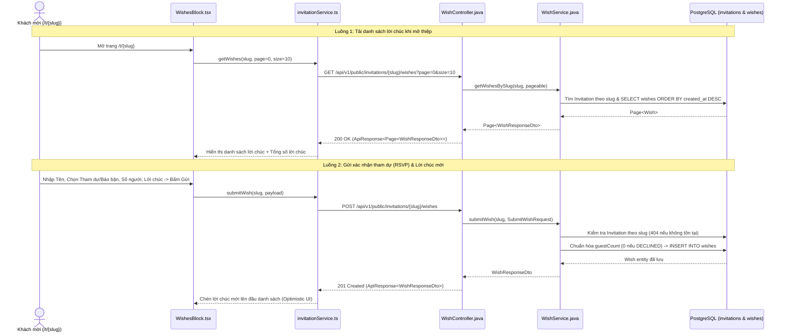

# 📋 KẾ HOẠCH TRIỂN KHAI CHI TIẾT GIAI ĐOẠN 1 (PHASE 1 EXECUTION PLAN)
## Khối Tương Tác Khách Mời: RSVP & Sổ Lưu Bút Lời Chúc (`feat/module-rsvp`)

> **Nhánh Git làm việc:** `feat/module-rsvp` (tách từ `develop`)  
> **Mục tiêu cô lập:** Hoàn thiện luồng khách mời xem thiệp công khai (`/t/{slug}`) gửi xác nhận tham dự tiệc cưới (RSVP + số người đi cùng) và lời chúc mừng, lưu trữ thực tế vào PostgreSQL và hiển thị tức thời trên Sổ lưu bút.  
> **Quy trình bắt buộc:** `Database & Backend` $\rightarrow$ `Test Postman/cURL xanh 100%` $\rightarrow$ `Frontend Service & WishesBlock UI` $\rightarrow$ `Test E2E trên trình duyệt`.

---

## 1. Kiến Trúc Luồng Dữ Liệu Giai Đoạn 1



---

## 2. Danh Sách File Tạo Mới & Chỉnh Sửa

### 2.1. Tầng Backend (`backend/`)
| Thao tác | Đường dẫn File | Trách nhiệm chính |
| :--- | :--- | :--- |
| **[NEW]** | `src/main/java/com/wedding/wish/entity/AttendanceStatus.java` | Enum định nghĩa trạng thái tham dự: `ATTENDING`, `DECLINED`, `MAYBE`. |
| **[NEW]** | `src/main/java/com/wedding/wish/entity/Wish.java` | JPA Entity ánh xạ bảng `wishes` kèm Index `(invitation_id, created_at DESC)`. |
| **[NEW]** | `src/main/java/com/wedding/wish/repository/WishRepository.java` | Spring Data JPA truy vấn phân trang theo `invitationId` và đếm số lượng. |
| **[NEW]** | `src/main/java/com/wedding/wish/dto/request/SubmitWishRequest.java` | DTO nhận dữ liệu gửi lời chúc kèm Jakarta Validation (`@NotBlank`, `@Size`, `@Min`, `@Max`). |
| **[NEW]** | `src/main/java/com/wedding/wish/dto/response/WishResponseDto.java` | DTO trả dữ liệu lời chúc chuẩn hóa cho Frontend. |
| **[NEW]** | `src/main/java/com/wedding/wish/service/WishService.java` | Nghiệp vụ kiểm tra `slug`, chuẩn hóa `guestCount` theo trạng thái RSVP, lưu và phân trang. |
| **[NEW]** | `src/main/java/com/wedding/wish/controller/WishController.java` | REST Controller tại `/public/invitations/{slug}/wishes` (GET & POST). |

### 2.2. Tầng Frontend (`frontend/`)
| Thao tác | Đường dẫn File | Trách nhiệm chính |
| :--- | :--- | :--- |
| **[MODIFY]** | `src/types/api.ts` | Cập nhật `AttendanceStatus`, `SubmitWishPayload`, `WishItemResponse`, `PageResponse<T>`. |
| **[MODIFY]** | `src/services/invitationService.ts` | Bổ sung 2 hàm `getWishes(slug, page, size)` và `submitWish(slug, payload)`. |
| **[MODIFY]** | `src/components/renderer/blocks/WishesBlock.tsx` | Kết nối API thật, thêm chọn số người đi cùng (`guestCount`), phân trang "Xem thêm" và xử lý trạng thái Loading/Error. |

---

## 3. Chi Tiết Triển Khai Từng Bước (Step-by-Step Checklist)

### Bước 1: Tạo nhánh Git cô lập
- [ ] Chuyển sang nhánh mới từ `develop`:
  ```bash
  git checkout -b feat/module-rsvp
  ```

---

### Bước 2: Xây dựng Tầng Database & Entity (`com.wedding.wish.entity`)
*(Lưu ý: `application-dev.yml` đang bật `ddl-auto: update`, Hibernate sẽ tự động tạo bảng `wishes` và index từ `@Table(indexes = ...)` của Entity, đồng thời kèm câu lệnh SQL chuẩn để chạy tay nếu cần).*

- [ ] **2.1. Tạo Enum `AttendanceStatus.java`:**
  - Giá trị: `ATTENDING` (Sẽ tham dự), `DECLINED` (Không thể tham dự), `MAYBE` (Chưa chắc chắn).
- [ ] **2.2. Tạo Entity `Wish.java`:**
  - Bảng `@Table(name = "wishes", indexes = @Index(name = "idx_wishes_invitation_created", columnList = "invitation_id, created_at DESC"))`.
  - Các trường:
    - `id`: `Long` (`@Id @GeneratedValue(strategy = GenerationType.IDENTITY)`).
    - `invitation`: `@ManyToOne(fetch = FetchType.LAZY, optional = false) @JoinColumn(name = "invitation_id", nullable = false)` liên kết tới `Invitation.java`.
    - `guestName`: `@Column(name = "guest_name", nullable = false, length = 100) String`.
    - `attendanceStatus`: `@Enumerated(EnumType.STRING) @Column(name = "attendance_status", nullable = false, length = 20) AttendanceStatus`.
    - `guestCount`: `@Column(name = "guest_count", nullable = false) Integer` (Mặc định `1` nếu tham dự, `0` nếu báo bận).
    - `message`: `@Column(name = "message", length = 500) String` (Cho phép `null` khi khách chỉ xác nhận RSVP).
    - `createdAt`: `@Column(name = "created_at", nullable = false, updatable = false) Instant` (Gán `Instant.now()` trong `@PrePersist`).
- [ ] **2.3. Tạo Repository `WishRepository.java`:**
  - `Page<Wish> findByInvitationIdOrderByCreatedAtDesc(Long invitationId, Pageable pageable);`
  - `long countByInvitationId(Long invitationId);`

---

### Bước 3: Xây dựng DTOs, Service & Controller (`com.wedding.wish`)
- [ ] **3.1. Tạo `SubmitWishRequest.java` (`dto.request`):**
  - `guestName`: `@NotBlank(message = "Tên khách mời không được để trống") @Size(max = 100, message = "Tên khách mời tối đa 100 ký tự")`
  - `attendanceStatus`: `@NotBlank(message = "Trạng thái tham dự không được để trống") @Pattern(regexp = "ATTENDING|DECLINED|MAYBE", message = "Trạng thái tham dự chỉ nhận ATTENDING, DECLINED hoặc MAYBE")`
  - `guestCount`: `@Min(value = 0, message = "Số người tham dự không hợp lệ") @Max(value = 10, message = "Số người đi cùng tối đa là 10")`
  - `message`: `@Size(max = 500, message = "Lời chúc không được vượt quá 500 ký tự")`
- [ ] **3.2. Tạo `WishResponseDto.java` (`dto.response`):**
  - Các trường: `Long id`, `String guestName`, `AttendanceStatus attendanceStatus`, `Integer guestCount`, `String message`, `Instant createdAt`.
- [ ] **3.3. Tạo `WishService.java` (Constructor Injection, có Javadoc chuẩn):**
  - **`submitWish(String slug, SubmitWishRequest request)` (`@Transactional`):**
    1. Tìm `Invitation` qua `invitationRepository.findBySlug(slug)` $\rightarrow$ Nếu không có, ném `new AppException(HttpStatus.NOT_FOUND, "Không tìm thấy thiệp mời với đường dẫn yêu cầu.")`.
    2. Parse `AttendanceStatus`:
       - Nếu là `DECLINED` $\rightarrow$ ép cứng `guestCount = 0`.
       - Nếu là `ATTENDING` hoặc `MAYBE` mà `guestCount == null || guestCount < 1` $\rightarrow$ gán mặc định `guestCount = 1`.
    3. Lưu `Wish` vào DB và map sang `WishResponseDto`.
  - **`getWishesBySlug(String slug, Pageable pageable)` (`@Transactional(readOnly = true)`):**
    1. Tìm `Invitation` qua `slug` (ném `404` nếu không tồn tại).
    2. Gọi `wishRepository.findByInvitationIdOrderByCreatedAtDesc(invitation.getId(), pageable)` và map sang `Page<WishResponseDto>`.
- [ ] **3.4. Tạo `WishController.java`:**
  - `@RestController`
  - `@RequestMapping("/public/invitations/{slug}/wishes")` *(Nằm trong `/public/**` nên được `SecurityConfig` cho phép truy cập không cần JWT)*.
  - `POST ""` $\rightarrow$ Gọi `wishService.submitWish(slug, request)` $\rightarrow$ Trả về `HttpStatus.CREATED (201)` bọc trong `ApiResponse<WishResponseDto>`.
  - `GET ""` (nhận `@RequestParam(defaultValue = "0") int page`, `@RequestParam(defaultValue = "10") int size`) $\rightarrow$ Giới hạn `size = Math.min(size, 50)` $\rightarrow$ Trả về `HttpStatus.OK (200)` bọc trong `ApiResponse<Page<WishResponseDto>>`.

---

### Bước 4: Kiểm Định Backend Độc Lập (QA Gate 1A - Trước khi chạm vào Frontend)
- [ ] **4.1. Đảm bảo có ít nhất 1 thiệp mẫu trong DB:**
  - Nếu DB chưa có thiệp nào, gọi `POST /api/v1/public/invitations/quick-create` để tạo 1 thiệp test (ví dụ lấy `slug` trả về).
- [ ] **4.2. Chạy 4 kịch bản kiểm thử API:**
  1. **Test 400 Validation:** Gửi `POST /api/v1/public/invitations/{slug}/wishes` với `guestName: ""` $\rightarrow$ Phải trả về `400 Bad Request` và message `"Tên khách mời không được để trống"`.
  2. **Test 404 Not Found:** Gửi `POST /api/v1/public/invitations/slug-khong-ton-tai/wishes` $\rightarrow$ Phải trả về `404 Not Found`.
  3. **Test 201 Created (Chuẩn hóa `guestCount`):**
     - Gửi 1 request `ATTENDING`, `guestCount: 3`, `message: "Chúc hai bạn trăm năm hạnh phúc!"` $\rightarrow$ Nhận `201 Created`, `guestCount = 3`.
     - Gửi 1 request `DECLINED`, `guestCount: 5`, `message: "Mình bận công tác xa, chúc mừng hai bạn nhé!"` $\rightarrow$ Nhận `201 Created`, hệ thống tự động đưa `guestCount` về `0`.
  4. **Test 200 GET Pagination:** Gọi `GET /api/v1/public/invitations/{slug}/wishes?page=0&size=5` $\rightarrow$ Nhận `200 OK` chứa danh sách lời chúc sắp xếp mới nhất lên đầu.

---

### Bước 5: Tích Hợp Tầng Frontend (`frontend/src`)
- [ ] **5.1. Cập nhật `frontend/src/types/api.ts`:**
  - Định nghĩa:
    ```ts
    export type AttendanceStatus = 'ATTENDING' | 'DECLINED' | 'MAYBE';

    export interface SubmitWishPayload {
      guestName: string;
      attendanceStatus: AttendanceStatus;
      guestCount: number;
      message?: string;
    }

    export interface WishItemResponse {
      id: number;
      guestName: string;
      attendanceStatus: AttendanceStatus;
      guestCount: number;
      message?: string;
      createdAt: string;
    }

    export interface PageResponse<T> {
      content: T[];
      totalElements: number;
      totalPages: number;
      size: number;
      number: number;
      last: boolean;
    }
    ```
- [ ] **5.2. Cập nhật `frontend/src/services/invitationService.ts`:**
  - Thêm hàm `getWishes(slug: string, page = 0, size = 10): Promise<PageResponse<WishItemResponse>>` gọi `GET /public/invitations/${slug}/wishes?page=${page}&size=${size}`.
  - Thêm hàm `submitWish(slug: string, payload: SubmitWishPayload): Promise<WishItemResponse>` gọi `POST /public/invitations/${slug}/wishes`.
- [ ] **5.3. Nâng cấp `frontend/src/components/renderer/blocks/WishesBlock.tsx`:**
  - Nhận prop `slug` từ `PageRenderer`.
  - **Khi ở chế độ xem mẫu/Studio** (chưa phải thiệp thật trong DB hoặc API trả 404 cho mã template mẫu như `hb04-basic`): Fallback êm ái về danh sách lời chúc mẫu (`DEFAULT_WISHES`) để giao diện xem mẫu không bị báo lỗi đỏ.
  - **Khi mở thiệp thật (`/t/{slug}`)**:
    - Tự động tải danh sách lời chúc trang đầu tiên (`page = 0, size = 10`).
    - Form nhập liệu:
      - Ô nhập `Tên của bạn` (`guestName`, bắt buộc).
      - Nút chọn `Sẽ tham dự` (`ATTENDING`) / `Không thể tham dự` (`DECLINED`).
      - Khi chọn `Sẽ tham dự`: Hiện bộ chọn `Số người tham dự` (1 người, 2 người, 3 người, 4 người, 5 người). Khi chọn `Không thể tham dự`: Ẩn bộ chọn số người.
      - Ô nhập `Lời chúc gửi tới dâu rể` (không ép `required` cứng nếu khách chỉ muốn xác nhận tham dự nhanh).
      - Nút gửi hiển thị trạng thái `Đang gửi...` (`isSubmitting`) và thông báo lỗi rõ ràng nếu API trả lỗi.
    - Danh sách lời chúc (Wish Feed):
      - Hiển thị tên khách, nhãn trạng thái (`Sẽ tham dự (2 người)` hoặc `Báo bận`), thời gian tương đối (`Vừa xong`, `5 phút trước`, `dd/MM/yyyy`) và nội dung lời chúc.
      - Khi gửi mới thành công: Đẩy ngay lời chúc vừa tạo lên đầu danh sách mà không cần reload trang.
      - Nếu ` !last` (còn trang tiếp theo): Hiển thị nút **"Xem thêm lời chúc"** để tải trang kế tiếp.

---

### Bước 6: Kiểm Định Đầu Cuối (QA Gate 1B - Nghiệm thu hoàn thành Giai đoạn 1)
- [ ] Mở trình duyệt ẩn danh truy cập `/t/{slug}` của thiệp thật.
- [ ] Gửi liên tiếp 3 phản hồi:
  1. Khách A: `Sẽ tham dự` - Đi `2 người` - Có lời chúc.
  2. Khách B: `Không thể tham dự` - Có lời chúc cáo lỗi.
  3. Khách C: `Sẽ tham dự` - Đi `1 người` - Không ghi lời chúc (chỉ xác nhận RSVP).
- [ ] Cả 3 phản hồi xuất hiện tức thì trên Sổ lưu bút với đúng nhãn số người.
- [ ] Bấm **F5 (Tải lại trang)**: Cả 3 phản hồi vẫn giữ nguyên 100% từ PostgreSQL.
- [ ] Kiểm tra `npx tsc --noEmit` (Frontend) và `mvn test-compile` (Backend) xanh 100% trước khi merge nhánh `feat/module-rsvp` vào `develop`.
