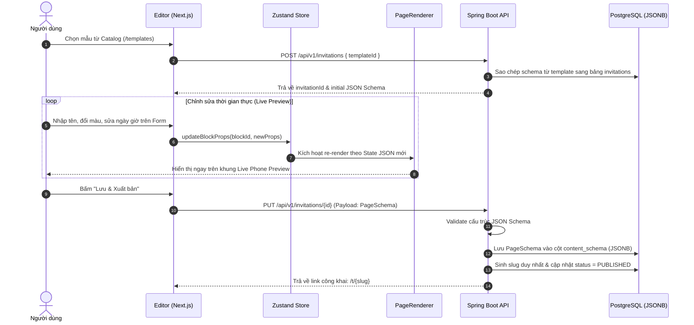
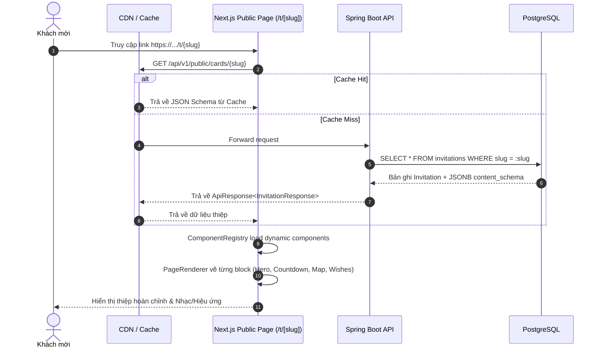

# Tài Liệu Kiến Trúc Hệ Thống (System Architecture Document)

> Dự án: **Nền tảng tạo và chia sẻ thiệp mời sự kiện trực tuyến (JSON-Driven UI)**  
> Tech Stack: **Frontend Next.js (TypeScript, Tailwind CSS) + Backend Java Spring Boot 4 + PostgreSQL (JSONB)**

---

## 1. Tổng Quan Kiến Trúc (Architecture Overview)

Hệ thống được xây dựng theo mô hình **Client - Server Decoupled** kết hợp kiến trúc **JSON-Driven UI (Server-Driven UI)**. Trong mô hình này, Backend không chỉ quản lý dữ liệu nghiệp vụ thông thường mà còn quản lý và kiểm soát toàn bộ cấu trúc giao diện (*Layout, Blocks, Props, Theme*) dưới dạng một cây dữ liệu JSON (**Page Schema**).

Frontend hoạt động như một công cụ dựng hình động (*Dynamic Renderer Engine*), đọc JSON Schema từ Backend để hiển thị giao diện cho cả Trình biên tập (*Editor*) lẫn Trang công khai (*Public Invitation View*).

### Sơ đồ kiến trúc tổng thể (High-Level Architecture)

```mermaid
graph TD
    subgraph Client ["Client Layer (Next.js / React)"]
        UI_Template["Template Catalog Page<br/>(/templates)"]
        UI_Editor["Editor Workspace<br/>(/editor/[id])<br/>• Form Controls<br/>• Live Preview Canvas"]
        UI_Public["Public Card View<br/>(/t/[slug])<br/>• Dynamic Renderer<br/>• Wishes Form"]
    end

    subgraph API_GW ["Network & Edge Layer"]
        CDN["Cloudflare CDN / Reverse Proxy<br/>• Caching /t/{slug}<br/>• DDoS / SSL Termination"]
    end

    subgraph Backend ["Backend Layer (Java Spring Boot 3)"]
        direction TB
        Ctrl["REST Controllers<br/>• TemplateController<br/>• InvitationController<br/>• PublicCardController"]
        Svc["Service Layer (Business Logic)<br/>• InvitationService<br/>• SchemaValidatorService<br/>• SlugGeneratorService"]
        Repo["Data Access Layer<br/>• Spring Data JPA + Hibernate 6"]
    end

    subgraph Storage ["Data & Storage Layer"]
        DB[("PostgreSQL 15+<br/>• invitations (content_schema: JSONB)<br/>• templates<br/>• wishes")]
        S3["Object Storage (Cloudflare R2 / AWS S3)<br/>• Hosted Images / Audio"]
    end

    Client -->|HTTPS / API Requests| CDN
    CDN -->|Reverse Proxy / Cached Hit| Backend
    Backend -->|CRUD & JSONB Queries (GIN Index)| DB
    Client -.->|Direct Asset Loading| S3
```

---

## 2. Luồng Nghiệp Vụ & Dữ Liệu (Data Flows)

### 2.1. Luồng tạo và chỉnh sửa thiệp (Editor Flow)



### 2.2. Luồng khách mời mở thiệp (Public View Flow)



---

## 3. Kiến Trúc Frontend (Next.js / React)

### 3.1. Cấu trúc Module & Phân Tách Trách Nhiệm
```
frontend/
├── src/
│   ├── components/
│   │   ├── editor/           # Giao diện Form nhập liệu & Controls
│   │   ├── preview/          # Khung giả lập điện thoại (Phone Mockup Frame)
│   │   ├── renderer/         # Bộ máy render JSON-Driven UI
│   │   │   ├── ComponentRegistry.ts  # Mapping giữa Block Type và React Component
│   │   │   ├── PageRenderer.tsx      # Bộ lặp duyệt block và dựng UI
│   │   │   └── blocks/               # Các component khối giao diện
│   │   │       ├── HeroBlock.tsx
│   │   │       ├── CountdownBlock.tsx
│   │   │       ├── LocationBlock.tsx
│   │   │       └── WishesBlock.tsx
│   │   └── common/           # ErrorBoundary, UI primitives
│   ├── store/                # Zustand State Management
│   │   └── useEditorStore.ts # Quản lý cây JSON Schema của Editor
│   ├── types/
│   │   └── schema.ts         # TypeScript Contract định nghĩa PageSchema
│   └── services/             # HTTP Client gọi API Backend (Axios/Fetch)
```

### 3.2. Dynamic Component Registry & Bundle Optimization
Để đảm bảo tốc độ tải trang cao nhất cho khách mời, Frontend sử dụng `dynamic()` với code-splitting:
- Chỉ tải mã nguồn của các Block xuất hiện trong `blocks[]` của thiệp.
- Bọc từng block trong `<React.Suspense>` và `<ErrorBoundary>` để lỗi dữ liệu ở 1 block không làm sập toàn bộ thiệp.

---

## 4. Kiến Trúc Backend (Java Spring Boot 3)

### 4.1. Cấu Trúc Gói Chuẩn Hóa
Tuân thủ tiêu chuẩn thiết kế hướng miền (*Domain-Driven Design*) và quy chuẩn Clean Code:

```
backend/src/main/java/com/wedding/
├── config/                   # WebMvcConfig, SecurityConfig, CorsConfig
├── controller/               # REST API Endpoints
│   ├── TemplateController.java
│   ├── InvitationController.java
│   └── PublicCardController.java
├── service/                  # Core Business Logic (Concrete Services, No Impl bloat)
│   ├── TemplateService.java
│   ├── InvitationService.java
│   ├── SlugGeneratorService.java
│   └── WishService.java
├── repository/               # Spring Data JPA Interfaces
│   ├── TemplateRepository.java
│   ├── InvitationRepository.java
│   └── WishRepository.java
├── entity/                   # JPA Entities
│   ├── Template.java
│   ├── Invitation.java
│   └── Wish.java
└── dto/                      # Data Transfer Objects
    ├── request/              # Incoming Payloads
    │   ├── CreateInvitationRequest.java
    │   ├── UpdateSchemaRequest.java
    │   └── SubmitWishRequest.java
    └── response/             # Outgoing Payloads
        ├── ApiResponse.java  # Standard API Wrapper
        ├── TemplateResponse.java
        ├── InvitationResponse.java
        └── WishResponse.java
```

### 4.2. Quản Lý JSONB Với Hibernate 6
Sử dụng trực tiếp `@JdbcTypeCode(SqlTypes.JSON)` trên entity Spring Boot 3 mà không cần thư viện ngoài:
- Cho phép map trực tiếp `Map<String, Object>` hoặc POJO `PageSchema` vào cột `JSONB` của PostgreSQL.
- Dễ dàng mở rộng thêm các trường thuộc tính trong schema mà không cần chạy migration DDL cho cơ sở dữ liệu.

---

## 5. Thiết Kế Cơ Sở Dữ Liệu (Database Schema)

### 5.1. Bảng `templates` (Kho Mẫu Thiệp Mặc Định)
| Cột | Kiểu Dữ Liệu | Ràng Buộc | Mô Tả |
| :--- | :--- | :--- | :--- |
| `id` | `UUID` | PRIMARY KEY | Khóa chính |
| `name` | `VARCHAR(100)` | NOT NULL | Tên mẫu (VD: Minimalist Luxury, Vintage Rose) |
| `thumbnail_url` | `VARCHAR(500)` | NOT NULL | Ảnh xem trước mẫu |
| `category` | `VARCHAR(50)` | NOT NULL | Danh mục (WEDDING, BIRTHDAY, OPENING) |
| `default_schema` | `JSONB` | NOT NULL | Cấu trúc JSON Schema mặc định của mẫu |
| `created_at` | `TIMESTAMP` | NOT NULL | Thời gian tạo |

### 5.2. Bảng `invitations` (Thiệp Người Dùng Đã Tạo)
| Cột | Kiểu Dữ Liệu | Ràng Buộc | Mô Tả |
| :--- | :--- | :--- | :--- |
| `id` | `UUID` | PRIMARY KEY | Khóa chính của thiệp |
| `slug` | `VARCHAR(100)` | UNIQUE, INDEX | Định danh duy nhất để tạo link public `/t/{slug}` |
| `user_id` | `UUID` | NULLABLE (MVP) | Khóa ngoại người sở hữu thiệp |
| `status` | `VARCHAR(20)` | NOT NULL | Trạng thái: `DRAFT`, `PUBLISHED`, `ARCHIVED` |
| `content_schema`| `JSONB` | NOT NULL | Toàn bộ cây dữ liệu JSON-Driven UI của thiệp |
| `published_at` | `TIMESTAMP` | NULLABLE | Thời điểm xuất bản |
| `created_at` | `TIMESTAMP` | NOT NULL | Thời điểm khởi tạo |
| `updated_at` | `TIMESTAMP` | NOT NULL | Thời điểm cập nhật lần cuối |

### 5.3. Bảng `wishes` (Lời Chúc Khách Mời)
| Cột | Kiểu Dữ Liệu | Ràng Buộc | Mô Tả |
| :--- | :--- | :--- | :--- |
| `id` | `UUID` | PRIMARY KEY | Khóa chính |
| `invitation_id` | `UUID` | NOT NULL, FK | Khóa ngoại liên kết bảng `invitations` |
| `sender_name` | `VARCHAR(100)` | NOT NULL | Tên người gửi lời chúc |
| `message` | `TEXT` | NOT NULL | Nội dung lời chúc |
| `attendance` | `VARCHAR(20)` | DEFAULT 'UNDECIDED'| Xác nhận tham dự (ATTENDING, DECLINED, UNDECIDED) |
| `created_at` | `TIMESTAMP` | NOT NULL | Thời điểm gửi |

---

## 6. Đặc Tả RESTful API Contracts

Toàn bộ API trả về cấu trúc chuẩn qua `ApiResponse<T>`:
```json
{
  "code": 200,
  "message": "Success",
  "data": { ... }
}
```

### Danh sách Endpoint chính

| Phương Thức | Endpoint | Quyền | Mục Đích |
| :--- | :--- | :--- | :--- |
| `GET` | `/api/v1/templates` | Public | Lấy danh sách mẫu thiệp có sẵn |
| `POST` | `/api/v1/invitations` | User/Session | Khởi tạo thiệp mới từ mẫu đã chọn |
| `GET` | `/api/v1/invitations/{id}` | Owner | Lấy toàn bộ schema của thiệp để đưa vào Editor |
| `PUT` | `/api/v1/invitations/{id}` | Owner | Lưu bản nháp (Draft) hoặc cập nhật JSON Schema |
| `POST` | `/api/v1/invitations/{id}/publish` | Owner | Xuất bản thiệp, hệ thống sinh ra `slug` định danh |
| `GET` | `/api/v1/public/cards/{slug}` | Public | Lấy cấu trúc JSON của thiệp cho khách xem |
| `POST` | `/api/v1/public/cards/{slug}/wishes` | Public | Khách mời gửi lời chúc và xác nhận tham dự |

---

## 7. Chiến Lược Bảo Mật & Tối Ưu Hiệu Năng (Production-Ready)

### 7.1. Chống XSS Injection trong JSON-Driven UI
- Vì nội dung từ `props` của JSON được render động ra HTML, Frontend bắt buộc phải escape và render text thuần, tuyệt đối không dùng `dangerouslySetInnerHTML` khi hiển thị lời mời hoặc thông tin do người dùng nhập.
- Backend validate và loại bỏ các thẻ script/mã độc trong các chuỗi string trước khi ghi vào cột `JSONB`.

### 7.2. Tối Ưu Hóa Bộ Nhớ & Truy Vấn JSONB
- **Không nhét ảnh Base64 vào JSON**: Nghiêm cấm đưa chuỗi Base64 của ảnh vào JSON Schema. Ảnh phải được upload lên Cloudflare R2 / AWS S3 và chỉ lưu đường link HTTPS vào JSON.
- **Index GIN**: Tạo GIN Index trên PostgreSQL cho các trường thường xuyên lọc bên trong JSON:
  ```sql
  CREATE INDEX idx_invitations_content_schema ON invitations USING gin (content_schema);
  ```

### 7.3. Caching & Khả Năng Mở Rộng
- Các thiệp đã xuất bản (`PUBLISHED`) có nội dung ít khi thay đổi đột ngột. Cấu hình CDN (Cloudflare) hoặc Cache-Control header (`public, max-age=300`) cho endpoint `/api/v1/public/cards/{slug}` giúp hệ thống chịu tải hàng vạn khách mời truy cập cùng lúc trong mùa cưới mà không gây quá tải cho Database.
